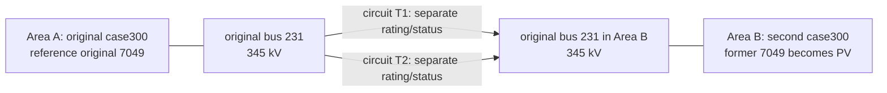

# GridSFM on case300 and a constructed two-area system

Research and experiment-design package for Ninad Sonawane, prepared 21 October 2026 (IST). **No case300/600 AC-PF, AC-OPF, GridSFM inference or training result is claimed.** Source inspection and the lightweight checks listed in the run log are completed. Proposed performance fields remain empty.

## 1. Recommendation and five decisions

**Choose matched parameter-efficient adaptation:** On one constructed interconnection of two MATPOWER case300 copies, can FFN-LoRA recover the accuracy and independently checked physical-feasibility gains of full GridSFM fine-tuning using 100 or 500 target scenarios, including held-out load imbalance and one single-tie outage?

This narrows the original robustness question to a controlled comparison that uses the existing adapter experience. The contribution would be empirical evidence about adaptation under a specific shift, not a new adapter algorithm or the act of joining two grids. The frozen model is a required baseline. Keep solver warm starting optional. [Closest prior work and three-angle comparison](../literature/evidence-and-novelty.md).

The five decisions that matter most:

1. **Fix the evaluated model release.** Start with Microsoft's v1.1 and a pinned Microsoft code commit plus explicitly imported archived FFN adapter changes. The October GridSFM preprint has a separate implementation/checkpoint lineage and a Newton-completion workflow; its results are context, not validation of this executable. Resolve version identity before experiments.
2. **Preserve the electrical problem.** Official case300 is the source. Preserve its internal branch ratings of zero (unlimited); impose disclosed synthetic ratings on the new circuits only. Reject silent parser/solver relaxations. Evaluate predictions against original matrices, not only normalized model features.
3. **Use one small, interpretable construction.** Two physical AC circuits between the same pair of compatible-kV terminal buses; one angle reference per connected island. Vary area loading with fixed costs. Hold one circuit outage out of adaptation. Do not sweep terminal pairs or tune them on final tests.
4. **Match the comparison and limit claims.** Same labels, nested 100/500 training sets, validation budget, initial checkpoint, loss and evaluation; rank 2 only; three training seeds. Report constraints and failures alongside cost. Parameter counts do not establish memory/time savings.
5. **Make integration a dated gate.** By 25 October require a numerical round trip and tiny training/memory pilot. If custom adaptation fails, switch to a frozen-model robustness study with the professor's agreement; if faithful inference fails too, deliver the integration findings rather than force a paper. Internal submission-ready date is 8 November, not an assumed extension.

**Scope:** ordinary balanced, steady-state AC-OPF. case300 is a diagnostic size/distribution test; the constructed 600-bus case is the paper target if validated. No LFAC, converters, dynamics, energy savings, arbitrary-grid generalization or global-optimality claims. Professor confirmation is needed for the terminal-pair interpretation, synthetic equipment assumptions and scientific focus. These questions do not block the initial research package.

## 2. Evidence and remaining novelty

The [full evidence table](../literature/evidence-and-novelty.md) contains nine primary papers with exact citations, versions, publication status, inspected sections/tables, results and limitations. A compact decision-oriented index follows; all results are the authors' reported findings.

| Source | Tested evidence relevant here | Remaining gap or restriction |
|---|---|---|
| Bhan, Yang, Capetz & Zhang, [GridSFM, arXiv v2, 2026](https://arxiv.org/abs/2609.30173v2), Sections III–VI | Pretraining on 54 grids of 500–4000 buses; 100-label adaptation and solver initialization | No matched FFN-LoRA comparison in inspected experiments; separate code lineage from Microsoft v1.1 |
| Yang et al., [Microsoft whitepaper, May 2026](https://www.microsoft.com/en-us/research/wp-content/uploads/2026/05/GridFM_white_paper.pdf), Sections 4–9 | Released multi-head model, adaptation, solver seeding | Technical whitepaper; published FT is not our matched baseline |
| Lovett et al., [OPFData v2, 2024](https://arxiv.org/pdf/2406.07234v2), Section 2 | FullTop/N-1 data on ten PGLib bases; generator or branch removal | No official case300 data; a successful-solve dataset does not certify failed solves as infeasible |
| Babaeinejadsarookolaee et al., [PGLib-OPF v2, 2021](https://arxiv.org/pdf/1908.02788v2), Tables V–VI | Standardized formulation and data completion, including case300 | Modified costs/limits mean PGLib is not untouched MATPOWER |
| Pan et al., [DeepOPF, IEEE Systems Journal, 2023](https://doi.org/10.1109/JSYST.2022.3201041), Section VI | AC-OPF state reconstruction/recovery, including modified 300-bus data | Raw predictions, recovery and achieved feasible cost must be separated |
| Dong et al., [Smart-PGSim, SC20](https://pasalabs.org/papers/2020/SC20_Smart-PGSim.pdf), Sections VI–VIII | Learned MIPS initializations on 14–300 buses; inference/retry time counted | Warm starting case300 is already established prior art |
| Karim et al., [AC-PF parameter-efficient adaptation v2, 2026](https://arxiv.org/pdf/2602.18227v2), Tables I–II | Matched full FT/LoRA/head comparisons on 4–32-bus synthetic graphs | PF rather than economic AC-OPF; defeats generic first-LoRA-PF novelty |
| Bernier et al., [PowerGraph-LLM, IEEE TPWRS, 2025](https://doi.org/10.1109/TPWRS.2025.3596774), Table I | LoRA on small-grid OPF language-model outputs | Parseable outputs are not an AC feasibility certificate; first-LoRA-OPF claim is unavailable |
| Hu et al., [LoRA, ICLR 2022](https://iclr.cc/virtual/2022/poster/6319), Sections 4–5 | Low-rank updates to frozen pretrained weights | Language-model memory figures do not transfer to this graph model |

**Hypotheses, not established contributions:** H1 adaptation improves held-out dispatch accuracy and tail balance residuals over frozen v1.1; H2 FFN-LoRA achieves a useful measured trade-off against matched FT at small data budgets; H3 intact-topology improvements may degrade on a withheld single-tie outage. Reject these if the data do not support them. Use effect sizes and uncertainty; a claim of equivalence needs pre-agreed non-inferiority margins, not a nonsignificant difference.

Unresolved claims: exact case300/related-case overlap with checkpoint pretraining; whether source-code/weights reproduce either paper's numerical results; actual memory/runtime on available hardware; and whether the provisional interconnection produces useful, solvable transfer stress. The inspected OPFData bases omit case300, but that is not a complete checkpoint contamination audit. Request a checkpoint-specific topology manifest from the authors only if later authorized to contact them. [Source and version audit](../technical/gridsfm-audit.md).

## 3. Reproducible setup, construction and conversion

### What is pinned and what is ready

| Component | Pin or state |
|---|---|
| Historical archive | research-learning `5b00e71e136e400445aab3a7a93bb8459cdd8a7c`; flattened GridSFM fork baseline `1e5e3a1640b27768e3eaf32680184f26b407caab` |
| Microsoft GridSFM code | `1ca775fd436d7ce013a1c0ab946e61ac7ef59ad6`, MIT |
| Microsoft HF revision | `1b41299b80252adf1869d5c3b479a4a402c52591`; v1.1 file SHA-256 `f8a4396122e603e8303afdebe3b093819c0f64dac0878394aed0bd63205fd831` from LFS metadata; bytes not yet downloaded |
| MATPOWER | release 8.1, commit `1a828c7af590714499284e36ee9c81273388c594` |
| Exact case300 source | SHA-256 `69a90280e999ef533d94656e0fbc08311f1347c962dd2753ff2005ff5e3f9ac5` |
| Local smoke path | Windows CPython 3.9.10; source/physics/protocol tests use stdlib, extracted-cycle/tiny-NN checks use existing torch 2.7.0+cpu, NumPy 2.0.1 and SciPy 1.13.1; no PyG; Python 3.13 also detected |
| Solver/ML readiness | MATLAB/Octave/nvidia-smi not on PATH; GPU hardware query denied; no GPU or working ML environment established |

Use an **isolated Linux/WSL environment for the GridSFM GPU path** after confirming it is available. Its PyTorch/PyG wheels and Linux-oriented setup must be resolved together; Windows stdlib checks passing do not validate that stack. Do not reuse the old PF/OPF Python environment. See exact commands, dependency pins/lock-generation steps and limitations in [GridSFM setup](../technical/gridsfm-audit.md) and [MATPOWER setup](../technical/matpower.md). A 16–24 GB CUDA GPU and 32 GB host RAM are planning allowances, not measured requirements or a claim that this machine has them. Batch 1 with accumulation 8 is the initial pilot setting; full FT must fit before committing to the comparison.

The released README's 500-bus lower range concerns documented training/support. The inspected graph loader does not establish a universal mathematical requirement that n>=500. Below-range case300 tests whether this implementation and its learned distribution transfer downward; failure cannot be attributed to size alone. A synthetic 600-bus graph is not automatically in-distribution. Run one bundled supported-size sample solely as an installation/control check. [Code audit](../technical/gridsfm-audit.md).

### Electrical assumptions from first principles

AC-PF solves voltages and balancing generation for a specified dispatch/load configuration. AC-OPF additionally chooses generator outputs to minimize the supplied cost subject to power balance and limits. A solver's success flag is necessary but insufficient: independently check the final equations and all enforced limits. A locally converged AC-OPF result is a numerical reference, not a globally optimal certificate.

The actual case has 300 buses, 69 generators, 411 branches and 69 quadratic active-cost rows; baseMVA=100. External IDs are nonconsecutive and extend to 9533; the reference is original ID 7049. There are shunts, multiple voltage levels and off-nominal taps, so neither a lossless graph nor row-number indexing represents it faithfully. All 411 RATE_A values are zero. That disables their thermal constraints; it does not mean the physical lines have infinite real-world capacity. [Pinned audit and acquisition](../technical/matpower.md), [MATPOWER case format](https://matpower.org/documentation/ref-manual/legacy/functions/caseformat.html).

Use the official `.m` file. PYPOWER is a separate port with its own source/version and solver; PGLib completes/modifies benchmark data. Neither is silently substituted. Keep the original bytes immutable, record their checksum, and serialize a fresh working case with explicit maps. `ext2int` removes inactive elements and type-4 buses and creates internal bus IDs; preserve `order` metadata, but inspect actual version behavior. **8.1 does not sort generator rows by default.** Cost blocks still require matching active/reactive rows under every filtering/reordering operation. Never carry stale `order` from one copy into a concatenated case. [Pinned implementation notes](../technical/matpower.md).

### Provisional interconnected system

The paired terminals are original bus **231**, source row **210**, in each copy: 345 kV and six incident branches in the source audit. This is an electrically compatible, well-connected illustrative choice; no geographic route is asserted. Two ties at different terminal pairs would create a different loop/transfer distribution, not a replicate of this experiment. Confirm the intended meaning with Professor Santoso.

Provisional per-circuit r=0.002 pu, x=0.019 pu, total charging b=1.127 pu on 100 MVA are copied as an illustrative electrical model from case300's 345-kV branch 4–16 (row 45), not measured for a proposed corridor. Each new row has synthetic RATE_A=600 MVA, status=1, tap=0 (MATPOWER unity convention), phase shift=0 degrees and angle bounds -360/+360 (disabled). The large charging must be retained and its reactive effect checked by PF/OPF; this is one reason the pilot must precede locking the network. The 600-MVA value is a study assumption, not a source rating. Freeze it using pilot/training behavior, never final tests. [Network configuration and rationale](../../configs/network-case300x2.json).

Use [the parameterized MATLAB construction and validation guide](../technical/matpower.md). It creates collision-free bus numbering plus persistent bus/gen/branch IDs and mapping sidecars. With no filtering, expect **600 buses, 138 generators, 824 branch rows**, one connected island and one reference. With T2 out, retain 824 rows but 823 active branches. Separate physical circuits permit individual ratings and outages. An equivalent parallel impedance might match intact admittance, but loses the per-circuit state/rating bookkeeping required here.

An angle reference fixes the arbitrary global phase origin; it is not an extra source of power. After connecting the grids, retain Area A's reference and change Area B's former REF to PV while its generator remains online. In PF that preserves voltage control and specified real power there; only one connected slack balances mismatch. In OPF outputs/voltage are optimized within the original limits, with one phase gauge. Do not independently fix both former phase references. Both ties out create two islands and require separate reference treatment, so that mode is excluded.

Initially identical costs and loads can yield nearly zero transfer. Use **load-only asymmetry**: multiply each area's signed Pd and Qd by lambda*(1+delta) in A and lambda*(1-delta) in B, with small seeded bus perturbations shared between nominal/outage partners. This retains each load's Q/P ratio (where defined); it creates unequal net demand but does not prescribe the resulting transfer. Recompute actual exchange as the sum of the two from-end real flows. Losses mean the opposite-end sum is not its exact negative. Cost asymmetry is a separate optional factor, not mixed into the minimum.

Before ML require connectedness, counts, IDs/cost correspondence, one reference, voltage-level compatibility, AC-PF/OPF solver status, nodal P/Q residuals, limits, total generation minus demand/shunt/branch losses, and equal per-circuit flows for identical intact ties. An outage is an individual row status change, not deleting identity. Outaging T1 or T2 is symmetric here; treat only one as an independent topology. Label the network **our constructed interconnected case300 system**, never an official IEEE/MATPOWER 600-bus case.

### Conversion without changing the OPF

The archived route is MATPOWER file → PowerModels parsing/OPF → Julia export → native `.pyg.json` → `load_pyg_json`/schema → transforms → model → evaluation. The exporter is useful as a schema reference, but default PowerModels validation can tighten disabled angle bounds to ±60 degrees and reverse branch directions. Its `correct_thermal_limits!` removes zero ratings (preserving unlimited); the separate `calc_thermal_limits!` routine can infer limits. Zero-cost-generator removal or optional feasibility repair would also change the problem. A direct, logged neutral-matrix conversion is safer for this study, with MATLAB OPF labels stored separately. [Full field mapping and code](../technical/conversion.md).

| Quantity | MATPOWER convention | Required GridSFM/round-trip check |
|---|---|---|
| Bus IDs/status | External IDs, BUS_TYPE and source row order | Explicit ext↔int↔graph maps; no ID-as-row arithmetic; one reference per active island |
| P/Q | MW/MVAr with baseMVA | Convert exactly once to pu when the schema expects it; preserve signed loads |
| V and angles | VM pu; VA/SHIFT/angle limits degrees | Graph radians only where declared; reference alignment and wrapped error for comparisons |
| Shunts/charging | Gs consumes MW, positive Bs injects MVAr at 1 pu; BR_B is total charging | Preserve sign; split charging half at each end; respect from-side tap |
| Transformer | Ratio=0 means1; phase shift on from side | Complex tap orientation verified against original branch equations |
| Costs | Polynomial in MW (and optionally MVAr) | If features use pu, coefficient for power k scales by baseMVA^k; keep generator/cost mapping |
| Branch limits | RATE_A=0 disables limit | Keep unlimited mask; do not fabricate finite ratings to satisfy a parser |
| Flow labels | PF,QF,PT,QT in source orientation | Exporter's historic `[pt,qt,pf,qf]` differs from model `[Pij,Qij,Pji,Qji]`; reorder by explicit branch identity |
| Solutions | Solver outputs and objective | Label tensors only; remove labels from features; changing labels must not change inference features |

The native loader supports inference but intentionally ignores solution labels. Training expects OPFData-style targets and transforms. The required custom adapter must build the same graph tensors, attach bus `[Va(rad),Vm]`, generator `[Pg,Qg]` and directed branch targets in audited units, and provide valid masks and per-graph feasibility labels only under a justified definition. Disable heuristic synthetic infeasibility augmentation for this minimum. Neither JSON export nor a case-name edit completes this integration. The supplied converter/adapter scaffolding is not a demonstrated functioning trainer; see its explicit execution status.

One-scenario gate: solve the original case; export immutable input and separate solved labels; convert/reload; reverse units/maps and compare every input; independently recompute P/Q balances, both-end flows, generator costs and limits from recovered labels; compare with MATPOWER results. Require identical active sets, limits and reference; objective relative difference <=1e-8; scalar input fields <=1e-12 in double precision; reconstructed injections/flows <=1e-8 pu. After float32 conversion use a separately recorded initial tolerance of 1e-5 pu and investigate failures before changing it. Cross-solver optimizers are not expected to choose identical local optima. Test serialized numerical identity separately from model prediction accuracy.

Parallel-edge gates: the archive already explicitly handles multiple edges in cycle bases. Check two-row identity through conversion, positional/cycle features, batched index offsets, flow-label direction, loss and metrics; then switch only T2 off and verify admittance/flows. A code reading or toy converter test alone is not an end-to-end pass. The archived loss's impedance clamp and learned-flow metrics require original-equipment evaluation outside the network. [Independent checker](../../scripts/python/physics_metrics.py) is tested on analytical toy cases, but awaits MATLAB cross-validation.

## 4. Minimum experiment matrix, metrics and acceptance gates

### Bounded experiment budget

| Stage | Scenarios / fits | Purpose and stop condition |
|---|---|---|
| CPU/source control | Official 300 source, constructed 600 static checks, one supported-size bundled sample | Structural checks now; actual solver/model controls remain to run |
| Pilot, excluded from paper splits | 12 declared operating points × intact/outage =24 OPF attempts; case300 base PF/OPF separately; 2 training fits of 20 steps | Validate electrical/conversion path and full-FT memory; stop on semantic mismatch, nonfinite loss or unavailable compute |
| Paper labels | 500 train,100 validation,200 nominal test,100 load-stress test,100 outage test =1000 attempted scenarios | Same 100 nominal test families have a paired outage; 900 independent load families, not1000 |
| Tuning | 2 learning rates ×2 adaptation methods at n=100, seed7 =4 fits | Same max 20 epochs, validation selection; rank2 fixed, no test access |
| Final adaptation | 2 methods ×2 budgets(100,500) ×3 seeds(17,29,43)=12 fits | 100 set is nested within500; initial weights/splits/evaluator identical |
| Frozen evaluation | One inference sweep over400 test scenarios plus controls | No fabricated training-seed replications; deterministic inference if supported |

At most **18 training fits including two tiny pilots**, not a Cartesian sweep. Exact proposed values are in [experiment.json](../../configs/experiment.json); generated scenario identities/seeds are in [the proposed manifest](../../manifests/scenarios/proposed-v1.json). These manifests record designs, not solved data. The pilot covers lambda in0.9/1.0/1.1 and delta in-0.1/0/+0.1, plus lambda1 with delta±0.2 and lambda0.85 with delta0. Nominal paper sampling uses lambda~U(0.9,1.1), delta~U(-0.1,0.1), bus multipliers~U(0.97,1.03). The stress slice keeps lambda range but |delta|~U(0.15,0.20). These are assumptions, not validated feasible ranges.

For failed references, retain solver logs/status and input IDs. Apply predeclared alternative starts; never silently delete, relabel or repeatedly resample until success. The training budgets mean **accepted numerical references**, not just attempts. If fewer than 500/100 train/validation references qualify, pause before unsealing tests, version a training-only replenishment manifest capped at100 extra attempts, and record any resulting shortfall; cut the 500 budget if needed. All400 test attempts remain in the coverage denominator. Compute prediction error only where a validated reference exists, but report physical residuals for finite predictions independently. Failed optimization is not a negative infeasibility-class label.

Run MATPOWER 8.1 MIPS AC-OPF with explicit feasibility/gradient/complementarity tolerances1e-8 and independent reference checks at1e-4 MW/MVAr or stricter; see solver code for exact option names. Use the same solver-default interior initialization first (`opf.start=1`); this need not use the source's supplied Pg/Vm. On failures, and on a prespecified 5% subset selected by seed 6201, compare a flat-voltage/conventional feasible-start attempt and a lightly perturbed-voltage start with explicit `opf.start=2`; log each objective/residual. Select the best independently validated local solution among attempted starts, retaining all. Different local solutions can have similar objectives; avoid misinterpreting state error as uniquely wrong dispatch. No global certificate is claimed.

Validation selection is fixed lexicographically: highest all-tested-constraint pass fraction, then lowest mean per-scenario max-P-plus-max-Q residual, then lowest normalized absolute cost error. The same rule selects checkpoint/learning rate for each method. Training is max 20 epochs, early-stop patience 5, effective batch 8; record actual updates and wall time. Equal epoch caps are a matched optimization budget, not equal runtime. No test-based choice of rank, learning rate, tie impedance/rating or load range.

**Budget assumptions:** allow one already-available CUDA GPU, physical batch1, and a pilot wall-time cap of 60 minutes per tiny training fit. If projected final runs exceed 12 GPU-hours total, first drop the 500-scenario budget; retain both methods and all 3 seeds. These are caps for planning, not predicted performance. No compute is purchased or long job launched by this task.

### Physical metrics and uncertainty

For each predicted voltage V and original network admittance Y, compute `S_net = baseMVA * V * conj(YV)`. Nodal residual is `sum(Sg)-Sd-S_net`, with bus shunts represented once in Y. Branch complex currents come from the original pi model and complex tap; calculate Sf and St independently at both ends. `physics_metrics.py` computes these with original row identities rather than a learned flow head. Never compare a total-capacity-normalized training loss to a raw-MW residual without conversion. [MATPOWER formulation/code](../technical/matpower.md), [conversion audit](../technical/conversion.md).

| Metric | Definition and unit | Proposed reporting/gate |
|---|---|---|
| Cost accuracy | abs(Cpred-Cref)/max(abs(Cref),1 currency/hour); also signed and absolute currency/hour | Separate raw feasible and infeasible dispatches; an infeasible low cost is not achieved operating cost |
| Voltage / angles | Vm absolute error pu; angle errors after common reference alignment and wrapping to[-180,180) degrees | Mean per scenario, median,95th percentile,maximum; no angle MAPE |
| Pg/Qg | Absolute MW/MVAr per generator and per-scenario aggregate | No division by individual zero generator outputs |
| Nodal balances | Maximum and mean absolute P and Q residual per scenario | Pass only if each maximum<=1e-3 MW/MVAr |
| Generator limits | Violation of active P/Q boxes; inactive generation should be0 | <=1e-3 MW/MVAr; any additional capability constraints must be implemented or excluded explicitly |
| Voltage limits | max(Vmin-Vm,Vm-Vmax,0) | <=1e-4 pu |
| Branch limits | max(abs(Sf),abs(St)) against each positive RATE_A | <=1e-3 MVA violation; unlimited interior branches reported as not thermally constrained |
| Angle limits | Original unwrapped angle-difference constraints when active | <=1e-3 degrees; not the wrapped error metric |
| Joint pass | Every tested equality/inequality passes in the same prediction | Finite predictions / all attempts and conditional reference coverage reported separately |

These thresholds are proposed numerical criteria, not operational safety certification. Repeat the feasibility summary at 10× looser thresholds as a sensitivity check; do not substitute the looser definition for the prespecified primary one. Report mean, median,p95,max for per-scenario errors, with global worst-node/branch extrema separately. Report sample counts and model/solver failures in every table. If all models fail the strict joint criterion, say so and compare residuals rather than inventing feasible performance.

Use paired model differences on the same scenarios; bootstrap load families (2,000 resamples, seed 4401), keeping each nominal/outage pair together. Report each of 3 training seeds and their spread; hierarchical seed/family bootstrap is descriptive with only 3 seeds. No result across one constructed topology establishes arbitrary topology generalization. Training only on both-tie cases supports a narrow held-out-outage test, not general N-1 security certification.

Efficiency is secondary: record trainable parameters, actual peak CUDA allocated/reserved memory and process/device measurement method, training wall time and actual steps. If any latency is reported, separate parsing/preprocessing/caching, inference, projection/repair and solver time; synchronize GPU timers, disclose batch size and repeat cold/warm trials. No energy claim without power measurement. An optional warm-start experiment needs actual solver ingestion of predicted initialization, fair conventional/flat starts, equal tolerances, retries, end-to-end time and comparable feasible cost; it is outside the minimum.

### Acceptance gates and empty result layouts

| Gate | Must pass before proceeding | Current result |
|---|---|---|
| G0 source/static | Checksums, maps, counts, statuses, costs, connectedness | See recorded structural-check artifacts; no electrical validation implied |
| G1 numerical network | PF/OPF validated on source and pilot; no silent relaxation; useful measured exchange | **Not run** |
| G2 conversion | One-scenario numerical round trip, no label leakage, both directions, parallel edges end to end | **Not run end to end** |
| G3 adaptation | Same checkpoint;20-step LoRA/FT backward passes; full FT fits memory | **Not run** |
| G4 final study | Frozen split protocol;12 final fits or documented reduced design; complete failures and provenance | **Not run** |
| G5 paper | Claims match evidence; five pages including references; professor/postdoc review | **Not drafted as a results paper** |

The [summary CSV](../../results/templates/summary.csv) deliberately has empty result cells. Table I in the paper will compare frozen/LoRA/FT by n and test slice: cost median/p95, balance p95, joint pass rate, parameters and measured memory. Figure1: small labeled interconnection and data pipeline. Figure2: two panels showing residual/feasibility versus realized area exchange and the adaptation comparison with seed intervals; nominal/outage distinguished. Use only these **two figures and one table**. Detailed checks and per-scenario CSVs belong in the repository, not extra paper pages. [Figure/table specification](../../paper/outline.md).

## 5. Five-page paper plan

Proposed title: **Matched Low-Rank Adaptation of GridSFM Under Inter-Area Transfer Stress**. Until results exist, contribution sentences are hypotheses: “We test whether…” and “We quantify…” rather than “We demonstrate superior…”. A frozen-only fallback must change the title and claims, e.g. **Physical Feasibility of Frozen GridSFM Predictions on a Constructed Two-Area System**.

| Content | Approximate pages |
|---|---:|
| Title, authors, abstract, introduction and bounded gap |0.65|
| AC-OPF problem, two-copy construction and assumptions, Fig.1 |0.90|
| Conversion audit, split/metrics and matched training protocol |1.05|
| Results and interpretation, TableI and Fig.2 |1.35|
| Limitations and conclusion |0.35|
| References |0.70|
| **Total** |**5.00**|

References count within the limit; no separate appendix is assumed. Use official PES conference template with names/affiliations, an abstract<=150 words and up to 5 keywords. The live public portal verifies the cutoff as **10 November 2026, 11:59 p.m. Eastern Time**, which is **11 November, 10:29 a.m. IST**. [Verified rules and portal evidence](../technical/conference-verification.md). The outline is a writing plan, not a fabricated completed manuscript.

## 6. Dated schedule and scope cuts

All dates use IST. There are20 calendar days from21 October to10 November; review availability is an assumption to confirm, not a booked commitment.

| Date | Deliverable / decision |
|---|---|
|21Oct|Send no message automatically. Ninad can review this package and the email draft; confirm postdoc contact/review windows, topology interpretation and compute availability.|
|22–23Oct|Postdoc/professor review of proposed focus; install isolated solver/ML environments; validate official case300 and constructed network. Limit work to two focused sessions/day around existing commitments.|
|24–25Oct|24-scenario pilot; round-trip and parallel-edge checks; one tiny LoRA/FT pilot. **25Oct hard integration gate.**|
|26Oct|Freeze source transforms, tie parameters, splits, thresholds and training config; generate labels with complete failure logs.|
|27–29Oct|Run bounded matched study if gates pass; four validation-only tuning fits then final seeds. If compute over budget, drop500-scenario arm, not the matched FT baseline.|
|30Oct|Close experiments, generate tables/figures and uncertainty; stop adding hypotheses. Send draft to postdoc only when authorized.|
|31Oct–2Nov|Postdoc review and numerical corrections; write complete five-page draft.|
|3Nov|Deliver professor-ready draft with artifact links and explicit limitations.|
|4–6Nov|Reserve professor review; fix only material errors, avoid new research arms.|
|7Nov|Final bibliography, units, template/page count and provenance checks; recheck portal for any changed notice.|
|8Nov,18:00|Internal submission-ready PDF and all author approvals; submission remains Ninad's authorized later action.|
|9Nov|Buffer for coauthor/portal issues.|
|10Nov Eastern /11Nov IST|Official cutoff23:59 Eastern on10Nov =10:29 IST on11Nov; do not rely on an extension.|

Fallbacks: if G3 fails but G1/G2 pass by 25Oct, propose frozen-only24-pilot+400-test robustness with the same physics checks; remove adaptation/efficiency claims. If resource limits arise after integration, retain100-label LoRA/FT with 3 seeds (6final fits), leaving500 as future work. If no meaningful stress is observed, revise using pilot data before split freeze and log the change; never choose tie ratings using final tests. If G1/G2 remain unresolved on 27Oct, deliver a methodological/integration report to the professor and reconsider this deadline. A rushed unvalidated paper is not a successful experiment.

## 7. Unsent email draft

The exact draft is saved in [email/professor-santoso-unsent.md](../../email/professor-santoso-unsent.md). It proposes the focus and outline, explains the rating/model-version issues, asks the most consequential questions and states that experiments have not been completed. No email or other external message was sent.

## 8. Saved record and handoff

Permanent home: [GridSFM-study](https://github.com/ninadsonawane/GridSFM-study). The request, selective context/history, decision, literature notes/BibTeX, source manifests, construction/conversion code, executable smoke checks, proposed scenario manifests, empty results and paper/email plans are tracked. No historical training results are relabeled as new results. Source histories remain linked in research-learning rather than falsely claimed to be transplanted.

Read [HANDOFF.md](../../HANDOFF.md) for exact execution status, blockers, next commands, branch and synchronization procedure. Final commit/push verification is reported in the delivery message and recorded in the dated log where possible; no self-referential commit hash is fabricated inside a commit. Large checkpoints/datasets are not in ordinary Git. Immutable retrieval links/checksums cover source artifacts; any ignored local source copy is disclosed in provenance.
