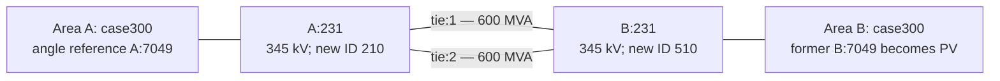

# MATPOWER acquisition, audit, construction and solver gate

Status on 21 October 2026: official source acquired and literal numeric matrices audited; Python construction and 13 structural tests executed. **No MATLAB/Octave runtime was detected on PATH or in the inspected standard Program Files locations. No AC PF/OPF, conversion-equivalence solve, or training run has been performed.** The MATLAB code is an unexecuted prototype. Python checks do not establish numerical feasibility.

## Pinned source and actual audit

Use [MATPOWER 8.1](https://github.com/MATPOWER/matpower/releases/tag/8.1), commit `1a828c7af590714499284e36ee9c81273388c594`, not a moving `master`. The release was published in July 2025. The annotated tag object is distinct from its commit. Raw `data/case300.m` SHA-256 is `69a90280e999ef533d94656e0fbc08311f1347c962dd2753ff2005ff5e3f9ac5`. Acquisition and permissions are recorded in [the source README](../../data/source/matpower-8.1/README.md); detailed reproducible counts are in [the audit](../../manifests/matpower-case300-audit.json).

These observations are newly computed from the actual pinned matrices, not copied from a different library's similarly named case:

| Property | Audited value | Consequence |
|---|---|---|
| Base | 100 MVA | Both copies already share one per-unit base |
| Matrices | 300 buses; 69 generators; 411 branches; 69 cost rows | Connected duplicate: 600/138/824/138 |
| In service | All 69 generators and 411 branches; no type-4 bus; one component | Baseline has no inactive equipment to drop |
| IDs | 1 through 9533, with gaps; 70 IDs exceed 300 | IDs cannot index a 300-row array |
| Bus types | 231 PQ, 68 PV, 1 REF; REF original ID 7049 | Connected copies need one angle reference |
| kV | 0.6, 2.3, 6.6, 13.8, 16.5, 20, 27, 66, 86, 115, 138, 230, 345 | A line between unlike levels would change the device model |
| Demand | 23,525.85 MW; 7,787.97 MVAr; 8 negative Pd and 13 negative Qd entries | Preserve signed injections; do not clip negatives to zero |
| Generation upper bounds | Total online Pmax 32,678.435 MW | Aggregate adequacy alone cannot establish AC feasibility |
| Costs | 69 model-2 polynomials, all NCOST=3; no Q-cost block | Preserve original cost coefficients and MW input units |
| Shunts | 17 nonzero Gs; 14 nonzero Bs; sums 1.3 MW and −492.78 MVAr at unit voltage | Shunts cannot be discarded as a negligible detail |
| Taps and shifts | 129 nonzero tap entries; 62 not equal to one; all shifts zero | Tap zero means nominal ratio; tap one may denote an explicit transformer |
| Ratings | **All 411 RATE_A values zero** | Original branches have no finite MVA constraints |
| Angles | All 411 bound pairs −360/+360 degrees | No active angle-difference constraints in this case |
| Existing parallel pairs | 9003–9006 and 9002–9012, each with two circuits | Multiedge support matters even before adding ties |
| Additional converter traps | Negative X at branch row179; no nonzero generator capability-curve columns | Preserve signed X; no capability constraints need translation for this source |
| Supplied initial voltages | 13 values outside bounds; range 0.9286–1.0735 pu | These source initial states are not accepted solved labels |

The source header records a June 2025 change that sets 22 nominal transformer tap entries from zero to one. This does not change the unity effective ratio, but it can change how a downstream parser categorizes devices. Therefore MATPOWER release choice belongs in provenance. See [pinned case header and matrices](https://github.com/MATPOWER/matpower/blob/1a828c7af590714499284e36ee9c81273388c594/data/case300.m).

MATPOWER's `case300`, [PYPOWER's port](https://github.com/rwl/PYPOWER/blob/master/pypower/case300.py), and [PGLib's curated OPF variants](https://github.com/power-grid-lib/pglib-opf) are separately versioned inputs. This study acquires MATPOWER's file directly. A future substitution requires a new manifest and numeric field diff, including ratings/costs, rather than retaining the same benchmark name.

## What the new network means

This is **our constructed interconnected case300x2 system**, not an official IEEE or MATPOWER 600-bus benchmark. The provisional interpretation is two physical AC circuits joining the same two buses. It needs professor confirmation.



Both source terminal IDs are **231**, each at 345 kV, source row **210**, with six incident active branches. This is a transparent connectivity-based starting choice, not a demonstrated best terminal or transfer capacity. New IDs 210 and 510 follow the explicit row-to-ID maps. Two ties at different terminal pairs would change entry points, internal flow patterns and cycle structure; that is a different topology experiment, not an interchangeable rendering of this one.

The [config](../../configs/network-case300x2.json) specifies two independent rows with r=0.002 pu, x=0.019 pu and **total** charging b=1.127 pu on 100 MVA. These electrical values are taken from original 345 kV branch row 45 (IDs 4–16) as an illustrative line template. They are not measured inter-area equipment data. The assumed 600 MVA rating per circuit is a study design parameter. At 345 kV it corresponds to about 1004 A; impedance is 2.3805+j22.61475 ohms because Zbase=(345 kV)^2/100 MVA. Nonzero charging remains explicit: nominal half-line charging is 56.35 MVAr per end per circuit before voltage effects. All RATE_B/C values equal RATE_A; only RATE_A is used in ordinary OPF. Both branches use tap=0 (effective one), shift=0, status=1 initially, and angle bounds −360/+360. [MATPOWER's branch model](https://github.com/MATPOWER/matpower/blob/1a828c7af590714499284e36ee9c81273388c594/lib/makeYbus.m) determines how these enter admittance.

Both copies preserve their internal original ratings at zero. Thus reported thermal-limit compliance covers the two rated ties, not all 824 branches. This limited scope is adequate for a study explicitly about inter-area exchange under assumed tie limits. Inventing ratings for the 822 internal branches would create another synthetic OPF benchmark and is excluded from the minimum. If the pilot shows the tie rating is never relevant or makes most selected conditions fail, revise it using calibration scenarios only, retain the superseded config, and freeze it before untouched test generation.

With identical costs and loads, two identical copies may produce nearly symmetric dispatch and little net exchange. Use `Pd_A,Qd_A = lambda*(1+delta)*(Pd,Qd)` and `Pd_B,Qd_B = lambda*(1-delta)*(Pd,Qd)`. This preserves the signed demand sum at fixed lambda and scales each bus's real/reactive demand together. Negative source entries remain negative. Costs and shunts are unchanged. The physical hypothesis is that demand imbalance creates a marginal-cost difference and exchange; this is not guaranteed. Measure actual tie flows before claiming transfer stress. Cost asymmetry, if later needed, is a separate experiment.

Both ties available has 824 active rows. One tie unavailable retains all 824 external rows and physical identities, with 823 active branches. Either identical tie outage is symmetric under swapping circuit names; evaluate only one in the minimum. Losing both ties creates two islands, so the constructor rejects it. A single equivalent parallel branch can reproduce a chosen intact-network admittance, but its one status/rating cannot preserve two separate outage choices and individual circuit loading. No parallel aggregation is allowed.

## Indexing, controls and costs

The MATLAB [constructor](../../scripts/matlab/build_case300x2.m) and Python [neutral constructor](../../scripts/python/matpower_case.py) rebuild required case fields explicitly. They map each original bus ID to a collision-free new ID and assign persistent area/equipment IDs. Generator order is `[A generators; B generators]`. When Q costs exist, correct cost order is `[P_A; P_B; Q_A; Q_B]`; naïvely concatenating complete `[P;Q]` blocks misaligns costs. This edge case is covered by an executed Python test. No per-unit rescaling is needed for identical baseMVA; mixing a different case/base would require a new construction implementation. Unknown extension fields are rejected in MATLAB rather than silently discarding custom OPF constraints.

Only Area A's original reference remains REF. Area B's former reference becomes PV, provided its online generator remains present. In PF, this retains voltage regulation while its Pg is prescribed and its Qg adjusts, subject to the chosen reactive-limit treatment; the one reference generator absorbs remaining active-power imbalance. In OPF, active/reactive dispatch and controllable voltage magnitudes are optimization variables within their limits; one reference fixes the angle gauge. Keeping a second REF in one connected island can impose an unintended second angle condition. [MATPOWER `bustypes`](https://github.com/MATPOWER/matpower/blob/1a828c7af590714499284e36ee9c81273388c594/lib/bustypes.m) and [AC OPF setup](https://github.com/MATPOWER/matpower/blob/1a828c7af590714499284e36ee9c81273388c594/lib/opf_setup.m) are the implementation references.

Call `ext2int` only on the finished case. Its `order` field records original matrices, active row selections and bus ID maps. Do not copy that field from one 300-bus source to the concatenated case. In pinned 8.1, normal `ext2int(mpc)` filters inactive/isolated equipment and renumbers buses but **does not sort generators by default**; generator sorting is an opt-in third argument and was default in older versions. Read the actual `order` metadata instead of relying on either ordering assumption. [Pinned `ext2int`, especially lines 129–132 and active-row selection](https://github.com/MATPOWER/matpower/blob/1a828c7af590714499284e36ee9c81273388c594/lib/ext2int.m).

## Acquisition and solver commands

From repository root, acquire the full official installation separately from the immutable case copy:

```sh
git clone --branch 8.1 --depth 1 https://github.com/MATPOWER/matpower.git work/matpower-8.1
git -C work/matpower-8.1 rev-parse HEAD
python scripts/python/matpower_case.py --git-dir work/matpower-8.1
python scripts/python/matpower_test.py
python scripts/python/matpower_case.py --construct configs/network-case300x2.json
```

The first command is unnecessary if that checkout already exists. Verify the printed commit before using it. The last command produces **unsolved** local neutral matrices and identity maps under `data/generated/`; these are not published datasets or successful solutions.

In MATLAB or GNU Octave, replace paths with your repository's absolute path:

```matlab
repo = 'C:/path/to/GridSFM-study';
cd(fullfile(repo,'work','matpower-8.1'));
install_matpower(1,0,1); % session path only; do not save global path
mpver;
test_matpower;
addpath(fullfile(repo,'scripts','matlab'));
mpc = loadcase(fullfile(repo,'data','source','matpower-8.1','case300.m'));
opt = mpoption('model','AC','pf.alg','NR','pf.tol',1e-9, ...
    'pf.enforce_q_lims',1,'opf.ac.solver','MIPS','opf.start',1, ...
    'opf.flow_lim','S','opf.violation',1e-7,'mips.feastol',1e-8, ...
    'mips.gradtol',1e-8,'mips.comptol',1e-8,'mips.costtol',1e-8, ...
    'mips.max_it',150,'verbose',1,'out.all',0);
[pf, pf_success] = runpf(mpc,opt);
[opf, opf_success] = runopf(mpc,opt);
pf_check = study_check_solution(mpc,pf)
opf_check = study_check_solution(mpc,opf)
run_matpower_smoke(repo,fullfile(repo,'runs','matpower-smoke-UNIQUE-RUN-ID'));
```

CLI equivalent after putting the same commands in a setup script: `matlab -batch "run('setup_and_smoke.m')"` or `octave --no-gui --quiet setup_and_smoke.m`. Install/runtime licensing and system setup are not performed by this package. MATPOWER supports both environments; its [installation guide](https://github.com/MATPOWER/matpower/blob/1a828c7af590714499284e36ee9c81273388c594/README.md) and [session-only installer arguments](https://github.com/MATPOWER/matpower/blob/1a828c7af590714499284e36ee9c81273388c594/install_matpower.m) specify the path setup. Avoid `addpath(genpath(...))` as a substitute for the installer.

`opf.start=1` explicitly uses the solver's default start; save the entire options struct. An occasional alternative-start check can use `opf.start=2` with an explicitly saved feasible PF/previous OPF initialization, retaining original limits/costs. Keep all failures and both solver outputs. These are local nonconvex numerical solutions, not certified global optima. Nonconvergence alone does not prove infeasibility.

## Validation before model involvement

[study_check_solution.m](../../scripts/matlab/study_check_solution.m) reconstructs admittance from **original equipment**, inserts solved V/Pg/Qg, and independently calculates nodal residuals, both-end flows, generator/voltage limits, active-power conservation, objective and configured angle bounds. MATPOWER branch flow equations include shunts, total charging split in half, complex taps at the from end and status. Positive Bs injects reactive power; positive Gs consumes active power. [makeYbus](https://github.com/MATPOWER/matpower/blob/1a828c7af590714499284e36ee9c81273388c594/lib/makeYbus.m), [makeSbus](https://github.com/MATPOWER/matpower/blob/1a828c7af590714499284e36ee9c81273388c594/lib/makeSbus.m), [totcost](https://github.com/MATPOWER/matpower/blob/1a828c7af590714499284e36ee9c81273388c594/lib/totcost.m).

Reference-label acceptance is solver success plus maximum absolute P/Q nodal residual ≤1e-6 pu (0.0001 MW/MVAr on 100 MVA), voltage bound excess ≤1e-5 pu, generator P/Q and rated branch excess ≤0.0001 MW/MVAr/MVA, angle-bound excess ≤1e-4 degrees, and finite metrics. These deliberately stricter numerical-reference tolerances differ from the proposed ML prediction gates (0.001 MW/MVAr/MVA, 1e-4 pu voltage). Also inspect objective agreement and flow recomputation error, expected counts, connectedness and sums. These are predeclared numerical checks, not claims of engineering adequacy. The supplied checker covers rectangular generator limits used by this case; a case with nonzero capability-curve constraints or user extensions would need additional checks.

Angle **error** may be reference-aligned and wrapped for prediction scoring. Angle **constraints** must follow the original unwrapped Va_from−Va_to. MATPOWER activates rows with its exact `makeAang` rule; when one bound is zero and the other nonzero, the zero bound can be active. Do not independently discard all zero bounds. [Pinned makeAang](https://github.com/MATPOWER/matpower/blob/1a828c7af590714499284e36ee9c81273388c594/lib/makeAang.m).

[export_study_neutral.m](../../scripts/matlab/export_study_neutral.m) writes original input matrices and physical IDs separately from solved labels (`vm`, `va_deg`, `pg_mw`, `qg_mvar`, both-end flows, objective, solver success, independently checked acceptance). Keeping solved voltages/dispatch out of the input matrices prevents the target from leaking into inference. Round-trip equivalence remains a blocking numerical gate; structural JSON conversion alone cannot satisfy it. See the companion GridSFM conversion audit and adapter.

## Executed and unresolved

Executed: pinned raw acquisition, source SHA and matrix audit, construction of a 600/138/824 unsolved neutral case, and 13 Python structural tests for source identity, references, terminal mapping, P/Q cost order, preservation of parameters, signed-load asymmetry, outage connectivity/IDs, and invalid inputs. Exact test output is stored in `manifests/matpower-execution.json`.

Unexecuted: all `.m` scripts, actual PF/OPF numerical results, objective/flow equivalence across converters, GridSFM consumption, and full end-to-end parallel-edge tests. MATLAB code should first be parsed/run under the chosen runtime and checked against the Python construction; no elapsed solver times, feasible scenario counts or objective numbers are reported. The initial neutral-export redirection failed because its scratch directory did not exist; the rerun succeeded, with both events recorded. A failed raw HTTP retrieval was resolved by read-only Git acquisition, not a different source.
