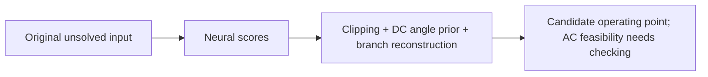

# Experiment 11A — setup and pipeline audit

22 October 2026 (Asia/Kolkata). **COMPLETE; stop for review.** Scope: original case300 only, source/feature/operator checks and single-input label-independence tests. No fitting, checkpoint selection, scenario sweep, 11B or 11C. Existing references and results were reused; no new AC-OPF or standalone AC-PF solve. The normal forward still calculates its built-in DC angle prior. No packages installed or old environment/source/checkpoint files modified.

## 1. Available releases: both runnable, kept separate

| Frozen row | Exact source commit | Checkpoint SHA256 | Parameters | Verified status |
|---|---|---|---:|---|
| Microsoft v1.1 | `1ca775fd436d7ce013a1c0ab946e61ac7ef59ad6` | `f8a4396122e603e8303afdebe3b093819c0f64dac0878394aed0bd63205fd831` | 15,148,227 | Hash, internal checksum, strict tensor load and finite forward pass |
| Newer base v2 | `517a07531ea55a11bd81a89a6c6879695a2ba4b4` | `9e5333ce0573a3322432cb96c1f62031abc457299a81f66871b10232ba8ea9c7` | 15,146,823 | Same checks pass; no adaptation checkpoint used |

The installed `GridSFM` checkout is actually the Seiole fork at `1e5e3a1640b27768e3eaf32680184f26b407caab`. Its model/data/physics files match the Microsoft pin, but five Python files differ, including loader/package exports. For an exact Microsoft row, the existing Microsoft Git object was exported into temporary storage and imported using the existing environment. No checkout or installation changed. [Full comparison](fork-comparison.json), [Microsoft evidence](microsoft-v1.1.json), [newer evidence](newer-base-v2.json).

Both released defaults use hard box clipping (`leaky_alpha=0`; newer `clip_mode='clamp'`). **Experiments9–10 explicitly used the newer code's sigmoid mapping**, as [their runner](../../../../experiments/gsfm007/common.py#L38) shows. Those historical rows must retain that setting in their names/method description. These releases also differ in input schema/availability features and parameter counts; shared branding is not proof of equivalent weights, architecture or guarantees. Checkpoint metadata records name and tensor hash, not an auditable training-data/loss lineage. **Main manuscript release still needs Dr. Li's confirmation; no message sent.**

## 2. Inputs and answer leakage

Inputs contain topology and original bus types/base kV/voltage limits, Pd/Qd, bus shunts, generator original PG/QG/VG, generator bounds/cost coefficients, and branch r/x/charging/taps/shifts/rating/angle bounds. Powers are converted to per-unit on the unchanged100MVA base; angles to radians. PE, cycle and graph-context features are calculated from these inputs. The newer adapter adds availability fields; all original case300 generators/branches are online.

Saved input matrices exactly matched the pinned **unsolved** source. PG/QG/VG features were checked against that source, not the reference solution; bus solution VM/VA are not bus input columns. On each release, removing labels or supplying two very different bogus solution/objective blocks produced **bitwise-identical returned tensor predictions**. This is evidence for this path, not permission to feed a solved `results.gen` matrix as input. [Loader](https://github.com/microsoft/GridSFM/blob/1ca775fd436d7ce013a1c0ab946e61ac7ef59ad6/model/gridsfm/data.py#L91), [converter](../../../../scripts/python/gridsfm_convert.py#L44), per-release `label_independence` records above.

## 3. Neural output versus numerical processing

Neural heads supply Pg and Qg scores, a voltage-magnitude score, an **angle residual**, and a feasibility-classifier logit. Pg/Qg/V are clipped to their individual stored FP32 input boxes. Numerical clipping is not a substitute for checking the original FP64 limits. Final angle combines a numerical DC prior with the bounded neural residual, then fixes the angle reference. The DC prior rescales a temporary copy of predicted dispatch internally; it does **not** rebalance returned generator Pg. A classifier probability is not a feasibility certificate. [Head/output code](https://github.com/microsoft/GridSFM/blob/1ca775fd436d7ce013a1c0ab946e61ac7ef59ad6/model/gridsfm/model.py#L230), [DC prior](https://github.com/microsoft/GridSFM/blob/1ca775fd436d7ce013a1c0ab946e61ac7ef59ad6/model/gridsfm/dc_prior.py#L90), [newer mapping](https://github.com/lukebhan/gridsfm/blob/517a07531ea55a11bd81a89a6c6879695a2ba4b4/model/gridsfm/model.py#L238).

Both forwards **calculate** branch-end P/Q from the same predicted phasors and branch parameters; there is no independent neural branch-flow head. Thus independent-head consistency is **N/A**. The Microsoft loss docstring describes an independent flow head, but the executable `_compute_flows` implementation contradicts that comment. Voltage/branch consistency follows from reconstruction under the chosen numerical operator; cycle-angle telescoping does not show that KVL was learned. [Actual reconstruction](https://github.com/microsoft/GridSFM/blob/1ca775fd436d7ce013a1c0ab946e61ac7ef59ad6/model/gridsfm/model.py#L283).

Native `predict()` does **not** perform nonlinear AC-PF completion or AC-OPF. The newer repository offers a separate Newton closure; our Experiments9–10 additionally recovered slack Pg/generator Qg and optionally applied the common external AC-OPF solver. Those later states must be labeled separately from clipped neural output. A converged closure solves balance under its numerical operator, with fixed controls; it does not enforce every operating limit or switch PV/PQ buses at Q limits. [Closure](https://github.com/lukebhan/gridsfm/blob/517a07531ea55a11bd81a89a6c6879695a2ba4b4/finetune_model/src/closure.py#L238), [study completion](../../../../experiments/gsfm007/common.py#L78).

## 4. What enforces each law/limit?

Training columns describe **available source code**, not verified historical training of these frozen weights. MS = Microsoft; newer elastic = the separate fine-tuning objective, not evidence about base-v2 pretraining.

| Law/limit | Input representation | Available training treatment | Hard output restriction | Processing after neural prediction |
|---|---|---|---|---|
| Nodal P/Q balance | Pd/Qd, topology, r/x, charging, taps, shunts, generator links | MS soft capacity-normalized KCL plus state/stress losses. Newer elastic: soft equality residuals/merit around separate PF closure. | None; clipping dispatch is not nodal balance. | DC angle prior is approximate. Optional AC-PF solves non-slack P/PQ Q and recovers slack P/regulating Q; external AC-OPF imposes full balances. |
| Generator active bounds | Original Pmin/Pmax; original PG as input | MS supervised Pg/stress; newer elastic soft P-bound penalty | Pg box clipping at the raw stage | PF slack recovery can leave its box. External AC-OPF imposes original bounds. |
| Generator reactive bounds | Original Qmin/Qmax; original QG | MS supervised Qg/stress; newer elastic penalizes recovered bus-level Q bounds | Qg box clipping at the raw stage | PF recomputes Qg without hard capability enforcement/Q-limit switching; external AC-OPF imposes individual bounds. |
| Voltage bounds | Original Vmin/Vmax; generator VG | MS supervised V/stress; newer elastic soft V violation penalty | Raw V box clipping | PF can move PQ voltages outside boxes; external AC-OPF imposes original bounds. |
| Thermal limits | Original RATE_A/B/C, with0 preserved | MS soft rated-flow/loading/barrier terms; excludes small ratings and `abs(x)<=0.01` in that loss path. Newer elastic penalizes both-end apparent power for RATE_A>0. | No flow-limit projection | PF has no thermal constraint; external AC-OPF/checker assess positive RATE_A at both ends. **All case300 RATE_A=0: N/A.** |
| Branch equations / KVL wording | Physical branch parameters and cycle features | Supervised/stress/branch terms; none establishes learned KVL | Flows algebraically reconstructed from one voltage state | Reconstruction uses an epsilon-modified operator; original exact checker remains authoritative. Independent-head test N/A. |
| Angle differences | ANGMIN/ANGMAX, shift in radians | Features/stress; no hard coupled branch-angle enforcement in native forward | Angle reference anchoring only | Original case300 ±360 bounds disabled; checker/external solver retain original semantics. |

Exact code: [MS loss aggregation](https://github.com/microsoft/GridSFM/blob/1ca775fd436d7ce013a1c0ab946e61ac7ef59ad6/model/gridsfm/loss.py#L651), [MS KCL denominator](https://github.com/microsoft/GridSFM/blob/1ca775fd436d7ce013a1c0ab946e61ac7ef59ad6/model/gridsfm/loss.py#L185), [MS thermal filtering](https://github.com/microsoft/GridSFM/blob/1ca775fd436d7ce013a1c0ab946e61ac7ef59ad6/model/gridsfm/loss.py#L323), [newer elastic equations and limits](https://github.com/lukebhan/gridsfm/blob/517a07531ea55a11bd81a89a6c6879695a2ba4b4/finetune_model/src/elastic_loss.py#L58), [external AC-OPF constraints](../../../../experiments/gsfm007/solver_server.jl#L22), [independent checks](../../../../scripts/python/physics_metrics.py#L72).

## 5. Original case and physics cross-check

Original MATPOWER8.1 case300: **300 buses,69 generators,411 branches**, all69/411 online, all411 RATE_A=0. Preserved:62 nonunity taps,29 shunt buses,8 negative-P-load buses,13 negative-Q-load buses,99 zero-P/Q-load buses and both parallel branch pairs. Original phase shifts are zero. Matrices, costs and IDs were unchanged. Case-file SHA256: `69a90280e999ef533d94656e0fbc08311f1347c962dd2753ff2005ff5e3f9ac5`. The manifest's old `data/source/...` local path is missing here; the hash-identical retained `results/inference/2026-10-21-base-cases/case300.m` was used. No source download was needed.

The known feasible exported/reloaded case300 reference was checked with installed, source-audited **PYPOWER5.1.21 makeYbus**, mapping external IDs explicitly. It includes bus shunts exactly once:

`r = Cg(Pg+jQg) - (Pd+jQd) - baseMVA * V * conj(Ybus * V)`

| Reference/operator | Max abs P (MW) | Mean abs P (MW) | Max abs Q (MVAr) | Mean abs Q (MVAr) |
|---|---:|---:|---:|---:|
| Original FP64 Ybus | 1.2254e-10 | 1.3790e-12 | 1.6636e-9 | 7.7975e-12 |
| Both releases' forward π operator, original coefficients FP64 + epsilon | 0.001149 | 0.00001797 | 0.0007845 | 0.000009343 |
| Both releases' native FP32 forward operator | 0.004060 | 0.0001511 | 0.023669 | 0.0006955 |
| MS stock-loss operator, original FP64 coefficients | 243.990 | 2.94728 | 193.285 | 1.74372 |

The independent branch-sum checker agreed with original Ybus residuals within **3.16e−11 MVA**, and both-end flows within2.98e−12 MVA. The reference also passed the unchanged original generator/voltage/angle/finite-rating coverage checks. A separate two-bus algebra unit fixture exercised nonzero phase shift, nonunity tap, shunt signs and an offline branch, agreeing within3.68e−13 MVA; it was not a benchmark scenario or solved label.

Forward reconstruction uses `r²+x²+1e−12`; MS stock-loss KCL uses `max(r²+x²,1e−6)`, affecting original branch rows1,317,321. The newer elastic objective instead calls its model π operator and has **no `gridsfm.loss` module**. This confirms operator differences on the same reference; it does **not** prove that either mismatch caused frozen prediction errors or that a given loss trained the checkpoint. No impedances or feasibility tolerances were changed. [Full precision/operator values](microsoft-v1.1.json), [newer values](newer-base-v2.json), [earlier frozen-state diagnostic reused](../../../diagnosis/2026-10-21-frozen-and-initialization/physics-mismatch.json).

## 6. Existing components and unresolved items

- **AC-OPF: available.** Existing Julia1.11.9 / PowerModels0.21.5 / Ipopt1.14.0 imports passed without compilation/installation; original-parameter ACP builder and independently checked case300 reference already exist. Local optima are not global certificates.
- **DC-OPF: available/importable, not benchmarked here.** PYPOWER5.1.21 `rundcopf` imports successfully; PowerModels DCP formulation is also present. No original-case300 DC-OPF result was generated in11A. A DC result would not itself certify AC feasibility.
- **Independent physics checker: available and now cross-checked against audited Ybus.** No numerical blocker found for the audited original case300 path.
- **Pending review:** Dr. Li's main-release choice; checkpoint-specific training/loss/topology lineage and pretraining overlap; whether later experiments should use shipped hard clipping or the explicitly declared sigmoid variant. No inference-guarantee claim is supported by training penalties, cycle features or a classifier.

## Reproduce only this audit

Use the existing environment; do not install anything. Export exact Microsoft source into temporary storage (the old fork has this Git object):

```sh
mkdir -p /private/tmp/gsfm011a-20261022-audit/microsoft-source
 git -C /Users/ninadsonawane/workspace/research-dev/GridSFM archive 1ca775fd436d7ce013a1c0ab946e61ac7ef59ad6 model | tar -x -C /private/tmp/gsfm011a-20261022-audit/microsoft-source
/Users/ninadsonawane/workspace/research-dev/GridSFM/model/.venv/bin/python -B experiments/gsfm011a/audit.py microsoft-v1.1
/Users/ninadsonawane/workspace/research-dev/GridSFM/model/.venv/bin/python -B experiments/gsfm011a/audit.py newer-base-v2
```

Audit outputs go to `/private/tmp/gsfm011a-20261022-audit/results`; committed evidence here is the completed copy. Exact source/file/checkpoint hashes, reference path/hash, environment, and setup-path/import corrections are retained. [Provenance](provenance.json). Earlier model predictions and references were not overwritten. This is a pipeline audit, not a fresh model-accuracy ranking.

**Stopped after11A; awaiting review.**


