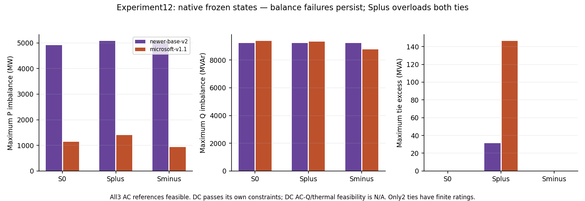
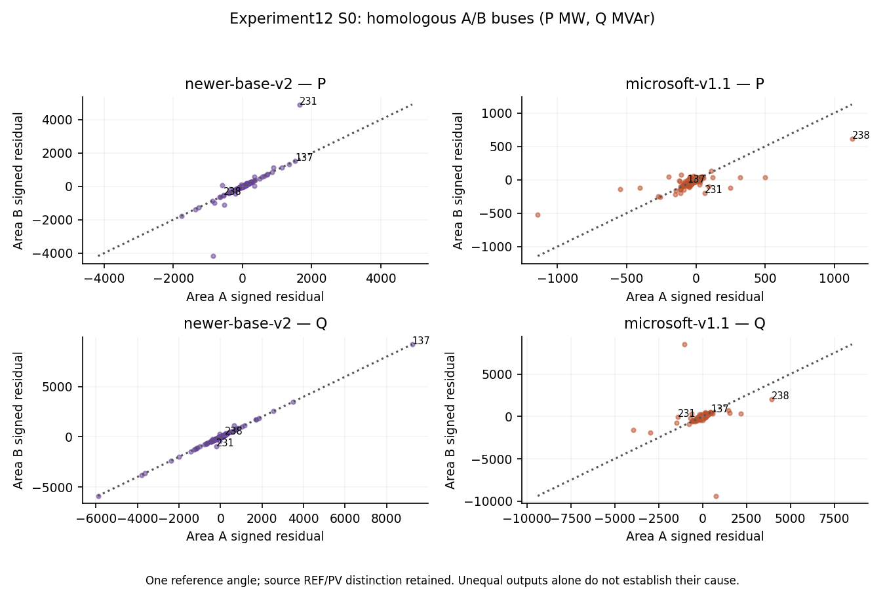
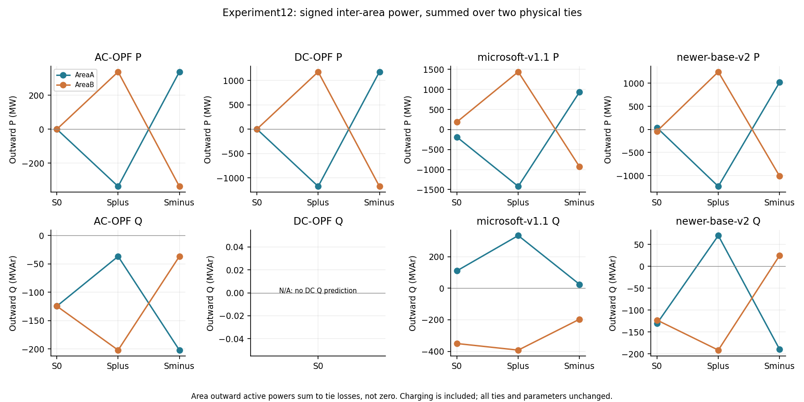

# Experiment12 — frozen releases on connected case300 copies

COMPLETE,23 October2026. Exactly S0(1/1),Splus(1.05/.95),Sminus(.95/1.05). Three AC references independently feasible; three DC runs converge and pass DC constraints; six native frozen states fail AC balance. No retry was required. Four additional poisoned-label audit forwards on S0 passed exact equality; these are correctness checks, not extra scenarios. No training, PF completion, OPF repair or result-driven network changes.

600 buses,138 generator rows,824 branches. Source original MATPOWER8.1 case300 and config network-case300x2.json unchanged. Two synthetic identical600MVA ties connect the345kV copies of original bus231; r.002,x.019,b1.127,tap0=unity,shift0. Only one REF remains (B's former REF is PV). All822 inherited lines remain unlimited. **Thermal coverage is only the two synthetic ties**, not the inherited grid. Mapping and input hashes are retained; every inherited field was checked. Original signed loads, costs, statuses, shunts, taps and parallel rows are preserved.

## Comparison

| Scenario | Method | Pg MAE MW | Angle MAE deg | Pflow MAE MW | Max P MW | Max Q MVAr | Tie excess MVA / DC MW | Joint AC |
| --- | --- | --- | --- | --- | --- | --- | --- | --- |
| S0 | AC-OPF | 0.000 | 0.000 | 0.000 | 2.03e-11 | 1.01e-10 | 0.000 | True |
| S0 | DC-OPF | 26.090 | 7.228 | 21.077 | 1.09e-11 | N/A | 0.000 | N/A |
| S0 | microsoft-v1.1 | 122.530 | 30.199 | 71.531 | 1.14e+03 | 9.38e+03 | 0.000 | False |
| S0 | newer-base-v2 | 106.044 | 48.986 | 94.724 | 4.92e+03 | 9.23e+03 | 0.000 | False |
| Splus | AC-OPF | 0.000 | 0.000 | 0.000 | 2.25e-11 | 1.83e-10 | 0.000 | True |
| Splus | DC-OPF | 31.635 | 36.536 | 38.601 | 6.62e-11 | N/A | 0.000 | N/A |
| Splus | microsoft-v1.1 | 125.752 | 35.581 | 87.059 | 1.4e+03 | 9.34e+03 | 146.375 | False |
| Splus | newer-base-v2 | 105.669 | 34.302 | 102.910 | 5.08e+03 | 9.23e+03 | 31.330 | False |
| Sminus | AC-OPF | 0.000 | 0.000 | 0.000 | 1.59e-11 | 1.22e-10 | 0.000 | True |
| Sminus | DC-OPF | 31.635 | 36.281 | 38.601 | 8.1e-11 | N/A | 0.000 | N/A |
| Sminus | microsoft-v1.1 | 120.419 | 56.011 | 79.606 | 940 | 8.76e+03 | 0.000 | False |
| Sminus | newer-base-v2 | 105.579 | 73.719 | 101.275 | 5.02e+03 | 9.24e+03 | 0.000 | False |

DC's Qg/Vm and AC feasibility are N/A. Its thermal column is an active-flow DC test, not apparent-power AC certification. Model branch flows use original exact FP64 phasor equations; native API outputs are archived before scoring. Full MAE/median/p95/max for Pg/Qg (per-generator and aggregated-generator-bus), Vm, angles, both-end P/Q; balance distributions/counts; bounds and rated-branch checks are in method-summary.json. Area accuracy/constraints are separate in area-accuracy-and-constraints.json. No global optimum is certified.

## Answers and electrical interpretation

1. All three constructed inputs have independently verified feasible local AC optima. Model conversion mappings, poisoned labels, solver roundtrip (loads/shunts/costs/limits) and original Ybus/branch-sum gates passed (<1e-6MW/MVAr). No constraint relaxation or impedance clamp was used. The failed-original1.10 case is unrelated and preserved.
2. DC has lower Pg and active-flow MAE than either frozen release on all three inputs. On Splus, both models have lower aligned-angle MAE than DC (MS35.581°,v234.302°,DC36.536°). This limited advantage does not establish AC feasibility or a universal ranking.
3. The600-bus construction does not remove native power-balance failures. Both releases fail on all three inputs; normalized area/bus metrics, not raw totals alone, are supplied for comparison with original300. It is not a standard IEEE600 benchmark or independent topology family, and the result does not isolate bus count or establish training exposure.
4. AC A-outward active interchange is approximately0,−337.097,+338.192MW for S0/Splus/Sminus. The opposing ends differ by tie losses (Splus B-outward+338.192MW), and reactive charging is explicit; two outward powers are not forced to negatives. On Splus both frozen models overload BOTH600MVA ties: MS maximum excess146.375MVA, v2 excess31.330MVA. They pass tie thermal tests in the other two inputs while still failing balance. Failures remain throughout inherited buses, not just the interface; interface-concentration.json quantifies the two tie buses versus elsewhere. Symmetric S0 areas produce unequal model outputs; A/B symmetry and reversed-load diagnostics are saved with the REF/PV/common-reference caveat. Differences alone do not identify their cause.
5. Interior thermal validity is N/A, and no outage, additional topology family, neural training, completion or speedup test was performed. This is inspected development evidence, not blind confirmation or a novelty guarantee.

## Reproduction and artifacts

Code:experiments/gsfm012_014/{run_cases.py,run_model.py,run_dc.py,solver_server.jl,electrical.py,report12.py,plots.py}. The existing read-only Python3.11/PyTorch/PyG/PYPOWER environment and Julia/PowerModels/Ipopt project were used. Audit settings are in scenario-manifest.json; exact commands, outcomes and default settings are in run-status.json/model metadata. AC uses audited formulation/tolerances,3000iterations/120s, one flat retry only on failure (unused). DC is audited MATPOWER-equivalent PIPS QP200 with the11B150iteration limits. Neither release's clipping was changed.

Run_cases refuses to overwrite completed attempts. Native states and raw matrices/solver containers remain local; artifact-inventory.json lists their hashes and paths. Readable tables, gates, mapping manifests, bus metrics, branch flows, area exchange, focus buses and paired diagnostics are preserved. Original11B–11D files are unchanged. This completes12;13 and14 are covered by the user's explicit instruction to run all three sequentially, with their own gates and separate reports.
