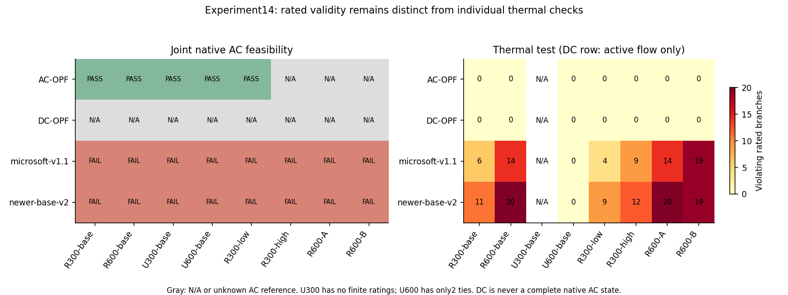
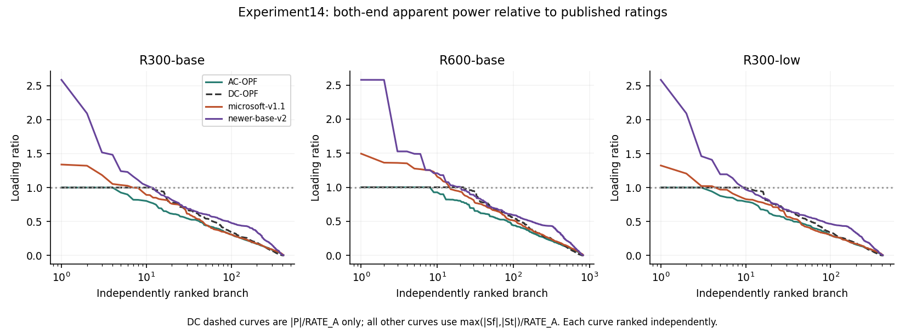
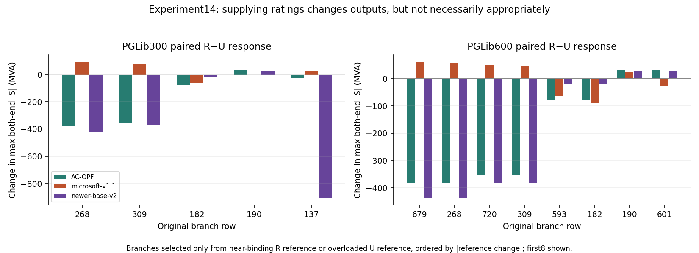

# Experiment14 — published rated PGLib variants and matched rating controls

COMPLETE,23 October2026. Exactly eight prescribed inputs;16 native frozen predictions plus8 poisoned-label audit forwards. Published source SHA2567ecf056d5942135765200ad7ae8791c28f0d35fb1dc888ba2c32dfc950f3c2f5 at PGLib commitdc6be4b2f85ca0e776952ec22cbd4c22396ea5a3; header v23.07 Typical Operations. Source/header/CC-BY attribution retained locally.300/69/411 online branches with411 finite positive ratings6–9900MVA. The full published case is used, not original MATPOWER plus transplanted ratings. matpower-versus-pglib.csv records3792 literal-field differences, including absent optional zero-valued generator columns; not every representation difference is a physical parameter change.

Two-copy rated variant:600/138/824; published interior ratings plus two unchanged synthetic600MVA ties. U controls disable only inherited RATE_A/B/C, with all other fields bitwise identical; ties stay rated. Field-level differences are saved. All12 fixed-Pg generators per source copy remain present with their exact published bounds; no widening or zero-denominator normalization. Both native releases pass their fixed-P checks and both rating-feature audits. RATE_A/B/C survive conversion and FP32 preprocessing in pu; branch-node input projection receives the raw features. RATE_A also enters global/stress features. This is source capability, not proof of training provenance or hard thermal enforcement. Zero ratings remain unlimited in independent scoring.

Published case attribution: [PGLib-OPF v23.07, pinned source](https://github.com/power-grid-lib/pglib-opf/blob/dc6be4b2f85ca0e776952ec22cbd4c22396ea5a3/pglib_opf_case300_ieee.m), distributed under [CC BY 4.0](https://creativecommons.org/licenses/by/4.0/). Its header credits original IEEE300 data to Richard D. Christie, University of Washington (1999). Our two-copy, loading and unlimited-rating derivatives are declared separately; the source file and license header are preserved locally.

## Outcomes

Verified feasible local AC references: R300-base, R600-base, U300-base, U600-base, R300-low. UNKNOWN (both default and deterministic flat attempts retained): R300-high, R600-A, R600-B. Failures are not proof of infeasibility. All three final failed iterates have about20.522MVAr maximum reactive imbalance; no reference-dependent errors or oracle labels are assigned there. Eight valid DC baselines converge and satisfy their own preserved DC constraints. All16 native frozen operating points fail AC balance; no raw native point is jointly feasible. No training, PF completion, OPF repair or extra input case was run.

| Input | Method | Ref valid | Pg MAE MW | P max MW | Q max MVAr | Rated count | Overloaded | Max excess | Max ratio |
| --- | --- | --- | --- | --- | --- | --- | --- | --- | --- |
| R300-base | AC-OPF | True | 0.00 | 0.00 | 0.00 | 411 | 0 | 0.00 | 1.000 |
| R300-base | DC-OPF | True | 69.40 | 0.00 | N/A | 411 | 0 | 0.00 | 1.000 |
| R300-base | microsoft-v1.1 | True | 147.61 | 1329.74 | 1380.92 | 411 | 6 | 151.54 | 1.339 |
| R300-base | newer-base-v2 | True | 150.14 | 3087.32 | 26003.47 | 411 | 11 | 15707.14 | 2.587 |
| R600-base | AC-OPF | True | 0.00 | 0.00 | 0.00 | 824 | 0 | 0.00 | 1.000 |
| R600-base | DC-OPF | True | 69.40 | 0.00 | N/A | 824 | 0 | 0.00 | 1.000 |
| R600-base | microsoft-v1.1 | True | 145.58 | 614.73 | 3191.22 | 824 | 14 | 190.40 | 1.493 |
| R600-base | newer-base-v2 | True | 153.49 | 2596.06 | 25928.42 | 824 | 20 | 15603.72 | 2.576 |
| U300-base | AC-OPF | True | 0.00 | 0.00 | 0.00 | 0 | N/A | N/A | N/A |
| U300-base | DC-OPF | True | 106.09 | 0.00 | N/A | 0 | N/A | N/A | N/A |
| U300-base | microsoft-v1.1 | True | 212.40 | 1985.92 | 4842.69 | 0 | N/A | N/A | N/A |
| U300-base | newer-base-v2 | True | 182.18 | 9134.90 | 18981.40 | 0 | N/A | N/A | N/A |
| U600-base | AC-OPF | True | 0.00 | 0.00 | 0.00 | 2 | 0 | 0.00 | 0.104 |
| U600-base | DC-OPF | True | 106.09 | 0.00 | N/A | 2 | 0 | 0.00 | 0.032 |
| U600-base | microsoft-v1.1 | True | 214.19 | 965.37 | 5291.64 | 2 | 0 | 0.00 | 0.221 |
| U600-base | newer-base-v2 | True | 181.59 | 9150.51 | 18992.36 | 2 | 0 | 0.00 | 0.108 |
| R300-low | AC-OPF | True | 0.00 | 0.00 | 0.00 | 411 | 0 | 0.00 | 1.000 |
| R300-low | DC-OPF | True | 58.87 | 0.00 | N/A | 411 | 0 | 0.00 | 1.000 |
| R300-low | microsoft-v1.1 | True | 162.91 | 1463.79 | 1783.60 | 411 | 4 | 145.24 | 1.325 |
| R300-low | newer-base-v2 | True | 164.55 | 3071.96 | 26002.15 | 411 | 9 | 15708.93 | 2.587 |
| R300-high | AC-OPF | False | N/A | 0.00 | 20.52 | 411 | 0 | 0.00 | 1.000 |
| R300-high | DC-OPF | False | N/A | 0.00 | N/A | 411 | 0 | 0.00 | 1.000 |
| R300-high | microsoft-v1.1 | False | N/A | 1190.89 | 1351.15 | 411 | 9 | 142.40 | 1.399 |
| R300-high | newer-base-v2 | False | N/A | 2731.63 | 25979.57 | 411 | 12 | 15665.39 | 2.582 |
| R600-A | AC-OPF | False | N/A | 0.00 | 20.52 | 824 | 0 | 0.00 | 1.000 |
| R600-A | DC-OPF | False | N/A | 0.00 | N/A | 824 | 0 | 0.00 | 1.000 |
| R600-A | microsoft-v1.1 | False | N/A | 1283.68 | 2802.98 | 824 | 14 | 371.20 | 1.693 |
| R600-A | newer-base-v2 | False | N/A | 2614.97 | 25927.59 | 824 | 20 | 15603.80 | 2.576 |
| R600-B | AC-OPF | False | N/A | 0.00 | 20.52 | 824 | 0 | 0.00 | 1.000 |
| R600-B | DC-OPF | False | N/A | 0.00 | N/A | 824 | 0 | 0.00 | 1.000 |
| R600-B | microsoft-v1.1 | False | N/A | 378.81 | 3861.34 | 824 | 19 | 163.29 | 1.511 |
| R600-B | newer-base-v2 | False | N/A | 2623.47 | 25930.07 | 824 | 19 | 15600.17 | 2.576 |

DC excess/count is a DC active-flow test, NOT AC apparent-power feasibility; Qg,Vm,AC-Q/AC-thermal and joint AC metrics are N/A. Failed AC rows are returned iterates, not references. U300 has no finite rating assessment; U600 assesses only ties. Full precision/locations/both-end powers and distributions are saved, including controlling end and group coverage.

## Findings

1. Rated bases R300/R600 and lower R300-low have feasible local references; high/area-shift rated cases remain UNKNOWN after the allowed flat retry. U bases are feasible. No global certificate or infeasibility proof is claimed.
2. Both frozen models violate finite thermal ratings on every rated input as well as balance. On R300-base, v1.1 overloads6 lines (max151.54MVA excess,ratio1.339) and v2 overloads11 (max15707.14MVA,ratio2.587). R600-base counts14/20 and maxima190.40/15603.72MVA. Interior versus synthetic ties are separate in thermal-by-group.csv. Native clipping of generator/voltage limits does not imply joint feasibility.
3. Compare DC and model shared Pg/angle/Pflow errors only where references passed; method-summary.json/csv has all comparisons and N/A elsewhere. DC has lower Pg and active-flow MAE on all5 reference-valid inputs. Both frozen models have smaller aligned-angle MAE than DC on R300-base, U300-base and U600-base; v2 also does on R600-base and R300-low. These limited angle advantages do not imply feasibility. Neither a DC active-flow pass nor a thermal-only model pass certifies an AC state.
4. Removing ratings materially changes the numerical reference. U outputs are independently rescored against R ratings in counterfactual-U-against-R.json; this is an audit of saved points, not another solve. Model R/U outputs also change, but their response does not produce joint feasibility. Full state/flow differences, binding reference branches and numerically relevant local branch changes are retained. On the5/10 reference-relevant branches of R300/R600, v2 changes maximum apparent flows in the reference direction on5/5 and10/10, but still overloads1/5 and2/10 of those branches; it also overloads other branches. v1.1 direction agreements are1/5 and5/10. This is a partial, localized response, not a blanket absence of rating response. The complete branch response and overloaded endpoint/imbalance context are saved. We do not infer neglect of ratings from invariance or confuse MATPOWER/PGLib differences with the matched ratings intervention.
5. The earlier mechanisms remain visible in large Vm/angle-driven branch flows and nodal imbalance; no claim is made that impedance alone or the training distribution causes failure. Published benchmark ratings are not measured historical equipment limits. Many limits are large; binding coverage is reported, not assumed. This bounded inspected screen is no novelty or cross-grid generalization guarantee.

## Important retained pipeline incident and execution counts

PYPOWER loadcase ignores a dict's version field via its width heuristic and interprets the compact published10-column generator table as v1. Its initial DC results reset ANGMIN/ANGMAX from±30 to±360; the round-trip assertion rejected those outputs. They are preserved as invalid-format-attempt0-* and excluded from all accepted baselines. Corrective solver-boundary canonicalization adds only the absent optional11 zero-valued MATPOWERv2 generator columns, verifies loadcase preserves the ORIGINAL fields and branch limits, then runs the same DC formulation/options. Published input JSON/matrices and model inputs are untouched.

**Actual DC calls:8 invalid-format attempts +8 corrected accepted solves**, an explicitly reported deviation from8 total calls. No extra scenarios, AC reruns or neural reruns were used for this fix. AC attempts total11 (8 default +3 allowed flat retries); native forwards16 plus8 label-audit forwards. Subsequent numeric metrics use only valid original-constraint DC states. The runner initially treated the adapter rejection as a failed baseline while other methods finished; it was not accepted as scientific evidence. dc-format-incident.json records the incident. Final converter/solver gates pass; prior results remain unchanged.

## Reproduction and evidence

Source and matrices/outputs are local-only with hashes; preserve attribution/license header. Code:experiments/gsfm012_014. prepare14.py builds exactly eight fresh input directories, run_cases.py is sequential with pre-solve matrix/parameter gates, run_dc.py canonicalizes only optional solver fields. report14.py and plots.py14 read saved results. Source diff, R/U rating-only diffs, fixed-P/rating feature audits, actual statuses, failed/invalid attempts, exact settings, both-end branch tables, thermal group coverage, counterfactual audits and rating response are retained. Checkpoint/source pins are unchanged from11A/B and12. No new environment or accelerator installation.
