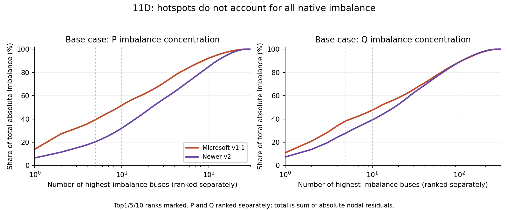
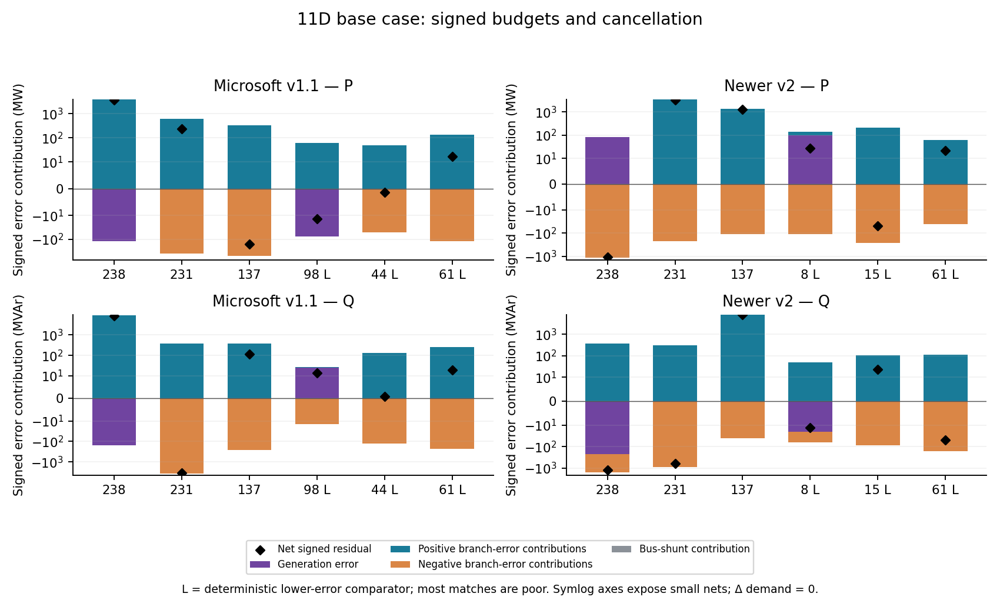
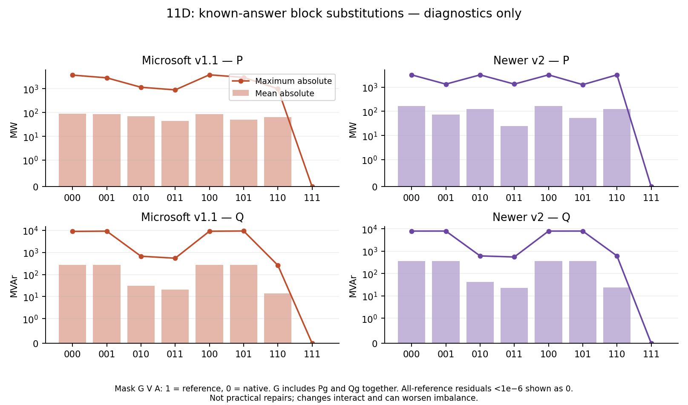
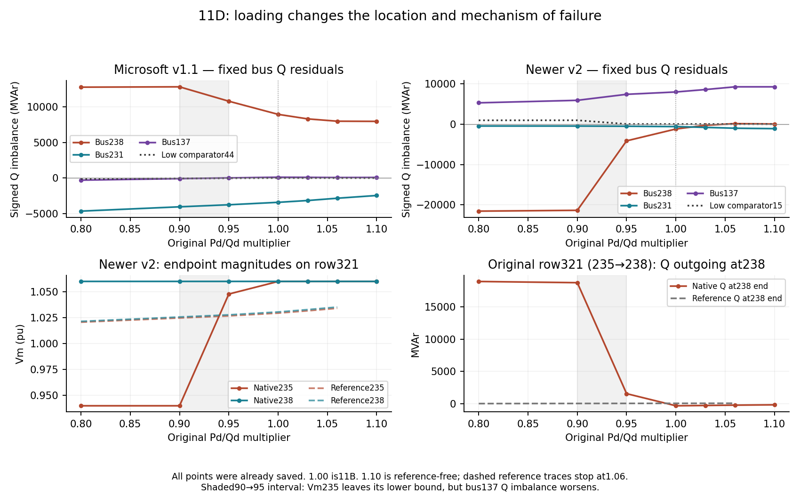

# Experiment11D — where case300 native power balance fails

22 October2026. COMPLETE. Saved states only: fourteen native predictions from two frozen releases over seven existing loading points, plus six previously verified AC-OPF reference states. No training, inference, new load scenarios, PF completion, OPF repair or network modification. Earlier11B/11C-1 artifacts were hash-verified and preserved. All substitutions below are **oracle diagnostics using known answers**, not improved predictions or practical repairs.

## Verification before interpretation

PASS. Across20 saved native/reference states, exact original FP64 branch sums and PYPOWER/MATPOWER makeYbus/Yf/Yt agree to1.1854e-10MW/MVAr; earlier signed bus residuals reproduce to1.1843e-10. Every native state is checked against the saved API fields: V pu, theta radians converted once to degrees, Pg/Qg pu multiplied by original100MVA. Original bus and generator-row mappings and every original branch-row mapping are verified. Both-end flows preserve original from/to orientation, from-side complex taps, phase shifts, line charging and parallel rows. Bus-shunt consumption is (Gs−jBs)|V|², counted once; positive Bs injects reactive power. Negative branch charging is retained. No denominator clamp, rounding or impedance modification is introduced in the authoritative evaluator.

Original case SHA256:69a90280e999ef533d94656e0fbc08311f1347c962dd2753ff2005ff5e3f9ac5. Microsoft v1.1 source1ca775fd436d7ce013a1c0ab946e61ac7ef59ad6 / checkpoint f8a4396122e603e8303afdebe3b093819c0f64dac0878394aed0bd63205fd831, leaky_clip with alpha0. Newer v2 source517a07531ea55a11bd81a89a6c6879695a2ba4b4 / checkpoint9e5333ce0573a3322432cb96c1f62031abc457299a81f66871b10232ba8ea9c7, shipped clamp. Installed source and checkpoint hashes match saved metadata at all seven loads. No weights were loaded into a model. Source input/checkpoint/state/settings hashes are in verification.json. The independent AC reference is a feasible local optimum, not a certified global solution.

At110%, the failed AC state is not read as a reference. Only the input and native model states are used for physical terms, branch flows, signed native budgets and loading trends; no oracle combinations or reference-error fields exist there. Original RATE_A=0 everywhere: thermal assessment remains N/A.

## Where: concentration of total absolute nodal imbalance

P totals are MW; Q totals are MVAr. Percentages use sum over all300 buses of |rP| or |rQ| separately, not a signed network total. These are imbalance totals, not network losses or power supplied.

| Release / component | Total absolute | Top1 % | Top5 % | Top10 % | Outside top10 |
| --- | --- | --- | --- | --- | --- |
| MS v1.1 / P | 26783.70 | 14.02 | 39.41 | 51.74 | 12926.39 (48.26%) |
| MS v1.1 / Q | 81782.22 | 10.93 | 38.42 | 47.54 | 42903.24 (52.46%) |
| Newer v2 / P | 49284.30 | 6.51 | 20.47 | 32.18 | 33423.71 (67.82%) |
| Newer v2 / Q | 109035.80 | 7.30 | 27.90 | 39.12 | 66377.19 (60.88%) |

For v1.1, top5P=[238,235,119,191,9001], top5Q=[238,235,9001,37,231]. For v2, top5P=[231,237,3,108,99], top5Q=[137,117,118,3,188]. Always-inspected238,231,137 are added to both sets. Focus and comparator IDs are fixed from this base case for all load tracking. Over48% of v1.1 P and52% of its Q, and over67% of v2 P and60% of its Q remain outside the top ten: this is not a single-bus failure.

## Which terms: signed base-case budgets

At every bus r=G−D−branch_out−bus_shunt. Demand is exactly identical to the reference, so ΔD=0. The signed error identity is r_pred−r_ref=ΔG−Δbranch_out−Δbus_shunt. Near-zero feasible r_ref is retained in full-precision data. Opposing contributions must not be summed as absolute improvements. All300 buses for both releases are in base-bus-terms.csv; all69 generator rows are in base-generators.csv.

| Release / bus | P or Q | Δ generation | −Δ branch out | −Δ bus shunt | Signed r |
| --- | --- | --- | --- | --- | --- |
| MS v1.1 / 137 | P | 0 | -152.78 | 0 | -152.78 |
| MS v1.1 / 137 | Q | 0 | 116.39 | 0 | 116.39 |
| MS v1.1 / 231 | P | 0 | 239.25 | 0 | 239.25 |
| MS v1.1 / 231 | Q | 0 | -3404.97 | 0.84 | -3404.13 |
| MS v1.1 / 238 | P | -117.26 | 3871.34 | 0 | 3754.08 |
| MS v1.1 / 238 | Q | -153.84 | 9076.12 | 15.69 | 8937.97 |
| Newer v2 / 137 | P | 0 | 1273.80 | 0 | 1273.80 |
| Newer v2 / 137 | Q | 0 | 7958.03 | 0 | 7958.03 |
| Newer v2 / 231 | P | 0 | 3210.67 | 0 | 3210.67 |
| Newer v2 / 231 | Q | 0 | -598.40 | -5.95 | -604.35 |
| Newer v2 / 238 | P | 84.30 | -1162.32 | 0 | -1078.01 |
| Newer v2 / 238 | Q | -227.24 | -970.35 | -9.23 | -1206.82 |

### Bus238: stiff connections amplify an endpoint-voltage mismatch

v1.1 predicts Vm238=0.97850pu versus reference1.03057. Neighbor235 is1.03070 versus1.02947. Original branch row321 (235→238) has r=0.0002,x=0.0006pu; its outgoing error at the238 end is−3270.25MW/−7605.32MVAr. Other incident rows304 (220→238) and389 (238→239, tap1.02 on238 side) contribute−396.23/−1049.46 and−204.86/−421.33. These are signed branch-power errors, not percentages. Generation errors−117.26MW/−153.84MVAr partly cancel the branch errors; the bus-shunt change contributes only+15.69MVAr to the residual error. Replacing generation alone therefore makes this bus worse.

v2 instead predicts Vm238=1.06000, Vm235=1.06000 and Vm220=0.99101. At base, row304 is the largest Q error: outgoing+1338.93MVAr, partly opposed by row321's−376.47MVAr. Row321 is the largest P error (+565.81MW); the generation errors+84.30MW/−227.24MVAr again interact with branch errors. The exact final r is−1078.01MW/−1206.82MVAr. The same bus can fail by different signed mechanisms in the two releases.

### Bus231: the important error can be at its neighbor or in a small angle difference

This PQ bus has no generator; G-block substitution cannot change its residual. Its original Bs=−300 gives positive reactive shunt consumption, correctly counted. For v1.1, Vm231 is close to reference (1.04926 vs1.05060), but Vm237 is1.03347 vs1.05271. Original row317 (231→237), r=0.0001,x=0.0006pu, contributes+3072.52MVAr of outgoing error; row316 adds+709.19 while other rows partly cancel it. Net Q imbalance is−3404.13MVAr; shunt-error contribution is only+0.84MVAr.

For v2 both endpoints of row317 are1.06000, but their angle difference is−0.97868° instead of−0.10449°. This row alone has−2720.63MW outgoing error; row266 adds−709.43MW and other rows partly oppose these. Net P imbalance is+3210.67MW. A near-correct local Vm or bounded endpoints cannot certify the connecting flows.

### Bus137: coherent low/high voltage gaps drive v2's largest base Q residual

This PQ load bus has no generator or bus shunt. v2 predicts Vm137=0.94000 versus1.04824; several neighbors sit near1.06000. Outgoing Q errors are−3176.28MVAr on row217 (137→188),−1846.83 on215 (137→181),−1244.82 on205 (133→137, evaluated at137), and−964.27 on214 (137→140); remaining rows contribute too. Net rQ=+7958.03MVAr. These are physically inconsistent imports into a bus with99.8MVAr demand, with no generator to offset them. v1.1 has a much smaller gap (Vm137=1.03957) and its signed branch errors cancel substantially, leaving−152.78MW/+116.39MVAr.

All incident branch impedances, original/effective taps, charging, endpoint shunts, endpoint Vm, angle differences and BOTH-end P/Q flows for predicted/reference states are in incident-branches.csv, separately keyed by original branch row and evaluated bus endpoint. Negative charging on row373 and every parallel row are preserved. The largest named-bus branch-error table follows.

| Release / bus | Quantity | Worst row (f→t) | r + jx pu | Native angle / ref deg | Native from Vm / to Vm | −Δ outgoing |
| --- | --- | --- | --- | --- | --- | --- |
| MS v1.1 / 238 | P | 321 (235→238) | 0.0002+j0.0006 | 0.1741 / -0.0722 | 1.03070 / 0.97850 | 3270.25 |
| MS v1.1 / 238 | Q | 321 (235→238) | 0.0002+j0.0006 | 0.1741 / -0.0722 | 1.03070 / 0.97850 | 7605.32 |
| MS v1.1 / 231 | P | 310 (226→231) | 0.0005+j0.0212 | 3.4119 / -0.8165 | 1.04229 / 1.04926 | 380.71 |
| MS v1.1 / 231 | Q | 317 (231→237) | 0.0001+j0.0006 | -0.1567 / -0.1045 | 1.04926 / 1.03347 | -3072.52 |
| MS v1.1 / 137 | P | 205 (133→137) | 0.0017+j0.0117 | -5.1673 / -3.2262 | 1.01616 / 1.03957 | -283.21 |
| MS v1.1 / 137 | Q | 214 (137→140) | 0.0015+j0.0114 | 2.9419 / 2.0941 | 1.03957 / 1.01249 | -209.77 |
| Newer v2 / 238 | P | 321 (235→238) | 0.0002+j0.0006 | -0.2795 / -0.0722 | 1.06000 / 1.06000 | -565.81 |
| Newer v2 / 238 | Q | 304 (220→238) | 0.0016+j0.0046 | -0.9338 / -0.8525 | 0.99101 / 1.06000 | -1338.93 |
| Newer v2 / 231 | P | 317 (231→237) | 0.0001+j0.0006 | -0.9787 / -0.1045 | 1.06000 / 1.06000 | 2720.63 |
| Newer v2 / 231 | Q | 317 (231→237) | 0.0001+j0.0006 | -0.9787 / -0.1045 | 1.06000 / 1.06000 | -847.21 |
| Newer v2 / 137 | P | 215 (137→181) | 0.0005+j0.0034 | -0.5763 / -0.1190 | 0.94000 / 1.01339 | 486.07 |
| Newer v2 / 137 | Q | 217 (137→188) | 0.0005+j0.0034 | -0.1276 / -0.7103 | 0.94000 / 1.06000 | 3176.28 |

## Low-error comparators: descriptive, mostly poor matches

Deterministic rule, applied separately per release at base: take the lowest75 of300 buses by max(|rP|,|rQ|), tie by original ID, exclude focus targets. Match each target independently (reuse allowed) by lexicographically preferring same bus type, generator-presence and structural-zero-injection status, then minimizing the sum of normalized signed Pd difference, Qd difference, kV difference, incident-row degree difference and unique-neighbor degree difference; final tie original ID. Each difference is divided by max(1,|target feature|); signed loads are retained. Poor=any categorical mismatch, unequal kV, or summed continuous distance>1. No comparator was selected by apparent narrative or by oracle outcomes. Full scores, Qd, shunts, degrees and profiles are in comparators.json.

A structural zero-injection bus has no online generator, Pd=Qd=Gs=Bs=0. Zero demand at a generator bus is not zero injection. Zero-demand bus117 has a shunt and is not structurally zero injection. The low-error pool contains no no-generator, zero-demand, nonzero-shunt match for117. Seventeen of18 matches are poor, so these are illustrations of relatively lower residuals, not controlled matched-bus causal evidence. Even their residuals are generally above the1e-3 feasibility threshold.

| Release / target→low | Type / gen | Pd target→low | kV target→low | Degree target→low | Low |P| / |Q| | Match |
| --- | --- | --- | --- | --- | --- | --- |
| MS v1.1 / 37→11 | 1 / 0 | 85→83 | 115→115 | 8→5 | 24.82 / 25.60 | poor |
| MS v1.1 / 119→7023 | 2 / 1 | 0→0 | 115→13.8 | 4→1 | 9.17 / 11.17 | poor |
| MS v1.1 / 137→61 | 1 / 0 | 273.6→227 | 230→115 | 7→3 | 16.67 / 18.65 | poor |
| MS v1.1 / 191→177 | 2 / 1 | 489→28 | 230→115 | 2→2 | 5.33 / 6.34 | poor |
| MS v1.1 / 231→44 | 1 / 0 | 159→195 | 345→115 | 6→5 | 1.40 / 0.89 | poor |
| MS v1.1 / 235→61 | 1 / 0 | 269→227 | 138→115 | 2→3 | 16.67 / 18.65 | poor |
| MS v1.1 / 238→98 | 2 / 1 | 255→66.7 | 138→115 | 3→2 | 14.20 / 13.47 | poor |
| MS v1.1 / 9001→210 | 1 / 0 | 0→0 | 115→115 | 4→5 | 11.76 / 10.45 | closer |
| Newer v2 / 3→113 | 1 / 0 | 20→26.2 | 230→115 | 7→2 | 11.41 / 3.35 | poor |
| Newer v2 / 99→90 | 1 / 0 | 83.5→66 | 115→115 | 5→3 | 9.10 / 23.88 | poor |
| Newer v2 / 108→9053 | 2 / 1 | 112.1→26.48 | 115→13.8 | 3→2 | 29.19 / 24.84 | poor |
| Newer v2 / 117→9025 | 1 / 0 | 0→0.45 | 115→0.6 | 2→1 | 0.30 / 2.67 | poor |
| Newer v2 / 118→55 | 1 / 0 | 14.1→22 | 115→115 | 4→4 | 20.91 / 26.40 | poor |
| Newer v2 / 137→61 | 1 / 0 | 273.6→227 | 230→115 | 7→3 | 22.00 / 47.32 | poor |
| Newer v2 / 188→71 | 1 / 0 | 182.6→116 | 230→115 | 4→4 | 2.42 / 41.36 | poor |
| Newer v2 / 231→15 | 1 / 0 | 159→126.7 | 345→115 | 6→6 | 48.16 / 22.66 | poor |
| Newer v2 / 237→74 | 1 / 0 | 0→0 | 345→230 | 5→4 | 6.02 / 37.32 | poor |
| Newer v2 / 238→8 | 2 / 1 | 255→63 | 138→115 | 3→3 | 26.67 / 12.61 | poor |

Representative examples: v1.1 bus44 (PQ load,115kV) has rP=−1.404MW,rQ=+0.887MVAr despite Vm error−0.02025pu. Its incident Q-error absolute sum is259.32MVAr; opposing errors cancel99.66%, leaving a small net. v1.1 bus98 has Pg error−75.86MW and net branch error−61.66MW, yielding rP=−14.20MW. v2 bus8 has Pg error+100MW partly offset by net branch error+73.33MW, giving+26.67MW; its Vm error is+0.02787pu. v2 bus15 has incident P-error absolute sum463.05MW but rP=−48.16MW (89.60% cancellation). The better structural match9001→210 (v1.1) compares two zero-injection115kV PQ buses;210 is still not feasible (rP11.76,rQ10.45). v2's zero-injection237→74 has a kV mismatch and is flagged poor. Lower imbalance does not establish accurate voltages, accurate individual flows or general physical validity.

## Which prediction blocks: all eight oracle combinations

1=reference,0=native; order G=(all Pg,Qg together), V=(all Vm), A=(all angles). Substitutions cover the complete network, with angles put in the same reference gauge. Every branch and bus shunt is recalculated. Below are maximum |rP| MW / |rQ| MVAr at base. Mean absolute, total absolute, signed total and fixed-bus signed residuals are saved for every combination at all six reference-valid loads (96 combinations). 000 reproduces native,111 reproduces the feasible reference. No110% reference or substitution is used.

| Reference blocks GVA | MS P max | MS Q max | v2 P max | v2 Q max |
| --- | --- | --- | --- | --- |
| 000 | 3754.08 | 8937.97 | 3210.67 | 7958.03 |
| 001 | 2884.39 | 9187.78 | 1329.26 | 7980.42 |
| 010 | 1158.90 | 672.68 | 3208.57 | 619.40 |
| 011 | 897.83 | 546.69 | 1333.19 | 553.23 |
| 100 | 3871.34 | 9091.81 | 3210.67 | 7958.03 |
| 101 | 3001.66 | 9341.62 | 1265.09 | 7980.42 |
| 110 | 1007.58 | 262.11 | 3208.57 | 619.40 |
| 111 | <1e-6 | <1e-6 | <1e-6 | <1e-6 |

Reference Vm alone reduces base maximum Q residual from8937.97 to672.68MVAr for v1.1 and7958.03 to619.40 for v2; both remain far outside tolerance. For v2, reference angles alone reduce maximum P3210.67→1329.26MW but Q worsens7958.03→7980.42MVAr. For v1.1, reference angles worsen maximum Q8937.97→9187.78, and reference G alone worsens P3754.08→3871.34 and Q8937.97→9091.81. For v2, G alone leaves the maxima unchanged (they occur at generator-free buses) while total absolute P/Q increase. With reference Vm+angles but native generation (011), the remaining maxima equal generator errors:897.83MW/546.69MVAr (v1.1),1333.19MW/553.23MVAr (v2). Thus generator errors also matter. Effects interact and cancel; do not add individual improvements or assign additive causal percentages.

## How loading changes the diagnosis

Named and comparator buses stay fixed. The complete predicted/reference signed term budgets and incident branches at all seven existing loads are saved; references/errors are null at110%. Selected signed residuals follow (*=11B reused base).

| Load | MS rP238 | MS rQ238 | v2 rP238 | v2 rQ238 | v2 rQ137 | v2 rP231 |
| --- | --- | --- | --- | --- | --- | --- |
| 0.80 | 5314.14 | 12750.09 | -7077.60 | -21535.70 | 5274.26 | 3026.84 |
| 0.90 | 4991.08 | 12796.76 | -7724.55 | -21338.70 | 5893.59 | 2795.82 |
| 0.95 | 4425.68 | 10778.39 | -2200.33 | -4139.30 | 7380.67 | 2913.39 |
| 1.00* | 3754.08 | 8937.97 | -1078.01 | -1206.82 | 7958.03 | 3210.67 |
| 1.03 | 3409.42 | 8301.25 | -628.60 | -292.60 | 8562.20 | 3510.29 |
| 1.06 | 3146.85 | 7975.34 | -336.52 | 118.88 | 9233.33 | 3872.94 |
| 1.10 | 2934.99 | 7952.51 | -208.38 | 20.16 | 9233.34 | 4399.15 |

The newer model's global maximum Q falls21338.70→7380.67MVAr between90% and95%, while total absolute Q falls141254.15→109807.21MVAr: a large local improvement does not remove broad failure. Bus238 rQ changes−21338.70→−4139.30, whereas bus137 worsens+5893.59→+7380.67 and becomes the largest Q residual. Bus231 P also worsens+2795.82→+2913.39MW and becomes the largest P residual.

The central saved-state change is Vm235:0.94000→1.04786pu, while Vm238 stays1.06000. Across original row321 (235→238), outgoing Q at238 falls18763.58→1563.10MVAr (change−17200.48), and outgoing P changes−5562.83MW. The angle difference changes only−0.31479°→−0.33521°. The total branch-out Q change at238 is−17210.45; ΔQg=−3.595, ΔQd=+7.45 and Δbus-shunt=0, giving the exact signed residual change+17199.40MVAr. These are signed identity terms, not independent additive oracle effects. Vm235 leaves its lower bound; the saved output does not reveal why the neural network moves it. At137, Vm181 rises0.94000→0.99244 while137 stays0.94000; row215's Qout changes−1419.99MVAr, explaining most of that bus's worsening despite a small demand increase.

At110%, native residuals/branch flows are still directly computable with original physics. v1.1 bus238 remains+2934.99MW/+7952.51MVAr; v2 bus231 is+4399.15MW and bus137+9233.34MVAr. No conclusion about110% AC feasibility is inferred from the failed solve.

## Four compact plots

1. Base concentration curves: where imbalance remains beyond the hotspots.
2. Signed error budgets: generation, positive/negative individual branch errors and shunt contributions, with net residual; lower nets can hide cancellation.
3. All eight base oracle block combinations: maximum and mean absolute P/Q; all-reference output is numerical zero at the display scale.
4. Fixed named-bus Q loading traces for both releases and the newer235–238 voltage/flow transition; all seven points are already saved.









## What this establishes, and what remains unexplained

The saved native failures are reproduced under two equivalent independent FP64 formulations; an evaluator/mapping/unit mistake is not supported by these checks. Exact branch equations show substantial voltage-magnitude mismatch across physically stiff original connections, angle mismatch driving active-flow errors, erroneous generation, and strong signed cancellation. Small original impedances amplify inconsistent endpoint states; they were not removed or changed. This does **not** establish that the model's denominator handling, rounding or any one training choice caused the voltage errors. The oracle tests diagnose state-block sensitivity, not learned causal mechanisms or usable repairs. Pre-clipping activations, training membership and checkpoint-training loss provenance are not available from these saved states. Nonunique local AC optima remain possible; physical infeasibility here is established by balance violations, not distance from one dispatch. The limited comparator matches preclude matched causal claims. KVL/branch consistency is imposed by reconstructing flows from one voltage field, not demonstrated learning of KVL. Thermal-security, solver acceleration, generalization to other grids and publication novelty are not established. Stop here.

## Reproduce and inspect

From the study repository, using the existing read-only Python environment:

```sh
/Users/ninadsonawane/workspace/research-dev/GridSFM/model/.venv/bin/python -B experiments/gsfm011d/diagnose.py
/Users/ninadsonawane/workspace/research-dev/GridSFM/model/.venv/bin/python -B experiments/gsfm011d/report.py
/Users/ninadsonawane/.cache/codex-runtimes/codex-primary-runtime/dependencies/python/bin/python3 -B experiments/gsfm011d/plot.py
```

All these commands are postprocessing only. They import no neural model, optimizer, PF or OPF entry point. The diagnose script aborts before interpretation if an integrity or physics gate fails. Scope:results/diagnosis/GSFM-011D/20261022-saved-states. verification.json and oracle-verification.json record the gates; tables.json is the compact table payload; CSVs contain all buses/selected incident rows/full oracle/load trajectories. Earlier raw input/model/checkpoint artifacts stay in their11B/11C-1 locations and are hashed, not duplicated. No large installation or further experiment was run.

## Appendix: every fixed base focus/comparator bus

| Release / bus | Role | rP MW | rQ MVAr | ΔVm pu | Zero injection? |
| --- | --- | --- | --- | --- | --- |
| MS v1.1 / 11 | low comparator | -24.82 | -25.60 | +0.01033 | False |
| MS v1.1 / 37 | top5 Q | 885.46 | 5088.44 | +0.00308 | False |
| MS v1.1 / 44 | low comparator | -1.40 | 0.89 | -0.02025 | False |
| MS v1.1 / 61 | low comparator | 16.67 | 18.65 | -0.05299 | False |
| MS v1.1 / 98 | low comparator | -14.20 | 13.47 | -0.04009 | False |
| MS v1.1 / 119 | top5 P | -1304.09 | 267.16 | -0.00259 | False |
| MS v1.1 / 137 | named | -152.78 | 116.39 | -0.00867 | False |
| MS v1.1 / 177 | low comparator | -5.33 | -6.34 | +0.03768 | False |
| MS v1.1 / 191 | top5 P | -994.76 | -372.27 | -0.05092 | False |
| MS v1.1 / 210 | low comparator | 11.76 | 10.45 | +0.02164 | True |
| MS v1.1 / 231 | named, top5 Q | 239.25 | -3404.13 | -0.00134 | False |
| MS v1.1 / 235 | top5 P, top5 Q | -3520.38 | -8111.30 | +0.00122 | False |
| MS v1.1 / 238 | named, top5 P, top5 Q | 3754.08 | 8937.97 | -0.05207 | False |
| MS v1.1 / 7023 | low comparator | 9.17 | 11.17 | -0.01831 | False |
| MS v1.1 / 9001 | top5 P, top5 Q | -982.38 | -5880.21 | +0.02673 | True |
| Newer v2 / 3 | top5 P, top5 Q | -1792.28 | -5590.76 | +0.04713 | False |
| Newer v2 / 8 | low comparator | 26.67 | -12.61 | +0.02787 | False |
| Newer v2 / 15 | low comparator | -48.16 | 22.66 | +0.01940 | False |
| Newer v2 / 55 | low comparator | -20.91 | 26.40 | +0.02900 | False |
| Newer v2 / 61 | low comparator | 22.00 | -47.32 | +0.02827 | False |
| Newer v2 / 71 | low comparator | -2.42 | 41.36 | +0.04618 | False |
| Newer v2 / 74 | low comparator | 6.02 | -37.32 | +0.02870 | True |
| Newer v2 / 90 | low comparator | 9.10 | -23.88 | +0.01961 | False |
| Newer v2 / 99 | top5 P | 1321.44 | 2557.64 | -0.07458 | False |
| Newer v2 / 108 | top5 P | -1336.92 | -2386.27 | +0.04472 | False |
| Newer v2 / 113 | low comparator | -11.41 | -3.35 | +0.06026 | False |
| Newer v2 / 117 | top5 Q | -487.65 | -7025.00 | +0.10594 | False |
| Newer v2 / 118 | top5 Q | 446.24 | 6056.17 | -0.00912 | False |
| Newer v2 / 137 | named, top5 Q | 1273.80 | 7958.03 | -0.10824 | False |
| Newer v2 / 188 | top5 Q | -407.44 | -3792.95 | +0.00773 | False |
| Newer v2 / 231 | named, top5 P | 3210.67 | -604.35 | +0.00940 | False |
| Newer v2 / 237 | top5 P | -2426.18 | 899.35 | +0.00729 | True |
| Newer v2 / 238 | named | -1078.01 | -1206.82 | +0.02943 | False |
| Newer v2 / 9025 | low comparator | -0.30 | 2.67 | -0.06879 | False |
| Newer v2 / 9053 | low comparator | 29.19 | -24.84 | +0.04138 | False |

Complete original-ID profiles, signed term errors and incident branches are in the linked CSV/JSON evidence.
