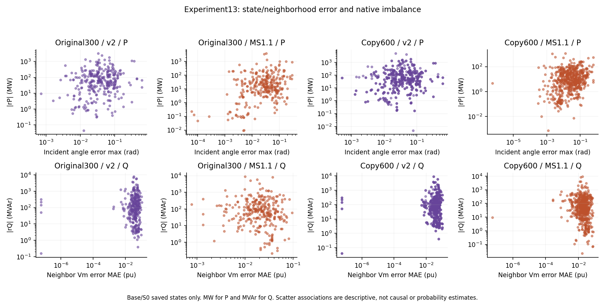
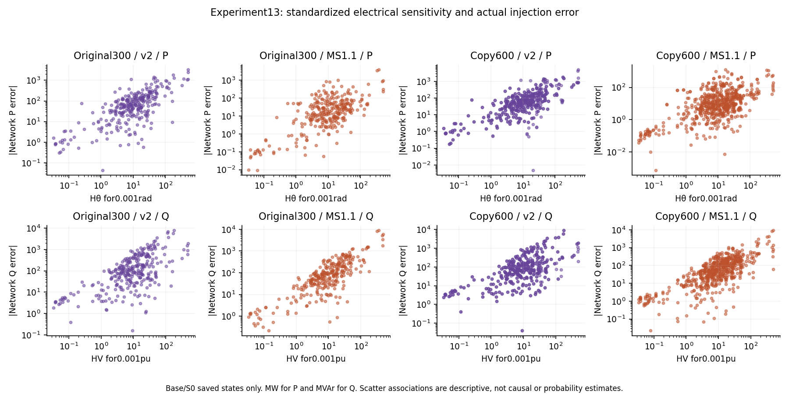
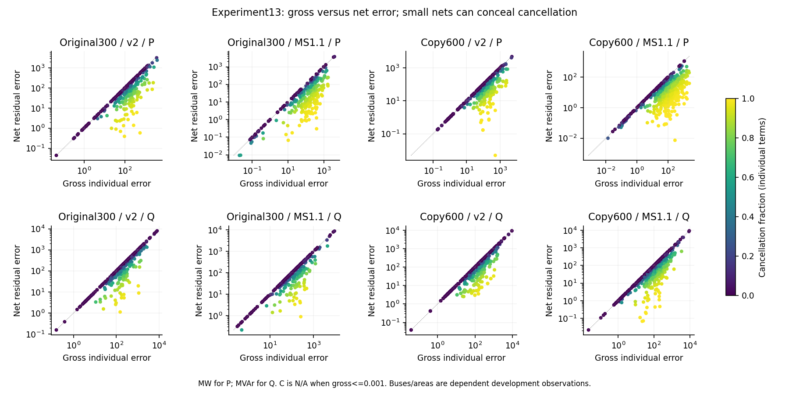
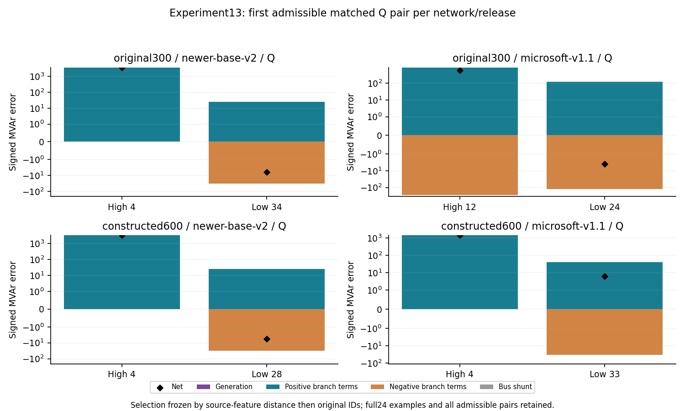

# Experiment13 — accuracy, standardized sensitivity and cancellation

COMPLETE,23 October2026. Saved original300 base plus five reference-valid loading points, and Experiment12 S0/Splus/Sminus. Two releases separately; newer v2 presented first as prespecified.18 saved model states,9 feasible references, no original1.10 reference use. **No new inference, training, PF completion, OPF solve or network modification.**

## Gates and admissible comparisons

Source-only structural pairs were enumerated and hashed before joining prediction outcomes.1537 admissible within-area pairs satisfy exact bus type, online generator count, kV, structural zero injection, shunt presence, transformer count and parallel excess; degree/unique-neighbor counts differ by<=1; signed Pd and Qd each satisfy the0.25 caliper with denominator max(10,|a|,|b|). Impedance, sensitivity and predictions were NOT matching features. All pairs, profiles/impedance distributions, eligibility and unmatched hotspots are retained. The first draft exported row indices as IDs; this reporting-only issue was corrected and rechecked against input IDs before accepting tables. Saved states were unchanged and no solves/inference were repeated.

| Network | Release | P/Q | Source pairs | Eligible high-low | Selected | Unmatched high |
| --- | --- | --- | --- | --- | --- | --- |
| original300 | newer-base-v2 | P | 506 | 33 | 3 | 63 |
| original300 | newer-base-v2 | Q | 506 | 35 | 1 | 61 |
| original300 | microsoft-v1.1 | P | 506 | 42 | 3 | 59 |
| original300 | microsoft-v1.1 | Q | 506 | 30 | 4 | 63 |
| constructed600 | newer-base-v2 | P | 1031 | 62 | 3 | 132 |
| constructed600 | newer-base-v2 | Q | 1031 | 118 | 5 | 119 |
| constructed600 | microsoft-v1.1 | P | 1031 | 80 | 3 | 117 |
| constructed600 | microsoft-v1.1 | Q | 1031 | 45 | 2 | 129 |

There are445 eligible high/low pairs across network/release/P/Q groups; up to6 per component/release across both networks selected by source distance then bus IDs (network as final tie),24 total. High/low native imbalance and prediction-error classifications are separate. No caliper was relaxed. Named hotspots238,231,137 often have no admissible low-imbalance counterpart; unmatched-hotspots.csv explicitly retains them instead of forcing poor matches. Across copied areas,299 homologous pairs remain after excluding the REF/PV pair; one-hop input-type differences are flagged. These are dependent descriptive controls, not randomized causal evidence.

## Electrical sensitivity and numerical validation

Analytical dS/dVm and dS/dtheta at each common AC reference are checked against full central finite differences at1e-6 and5e-7, excluding the single fixed reference-angle coordinate. All rows and blocks pass. Largest half-step relative Frobenius disagreement is3.488e-10; largest analytic-versus-half-step disagreement2.757e-10. Original FP64 branch/Ybus gates and signed residual-error identities pass.

H_V is row-sum absolute voltage derivative×0.001pu; H_theta is row-sum absolute angle derivative×0.001rad. They are separate worst-case linear response bounds in MW or MVAr, not observed errors, probabilities, or a single composite score. Actual J*dx, exact network-injection change and signed nonlinear remainder are recorded. For J*dx, angles use the full saved difference after one common reference alignment; no independent area rotation. Large observed errors need not lie in a valid local-linear regime.

## Findings and three plain-language examples

1. **Genuinely accurate neighborhood:** none of the primary base/S0 neighborhoods passes the declared strict example rule (all own/neighbor |Vm error|<=0.001pu, incident angle-difference errors<=0.001rad, and generator errors<=0.001MW/MVAr where generators exist). This does not say every individual variable is inaccurate; it prevents presenting a merely low residual as an accurate full neighborhood. Lower-error examples under weaker criteria remain in the complete tables.
2. **Electrically sensitive neighborhood:** original bus231 at the accepted base reference has Q H_V≈479.72MVAr per declared0.001pu perturbation box and P H_theta≈504.19MW per0.001rad box. These reference/network sensitivities are the same for both releases; actual native residuals differ. In v2, small angle-difference errors on the stiff231–237 connection amplify active-flow error, while voltage gaps at137 amplify Q. Large admittance alone is not a complete explanation; actual dx and nonlinear remainders are explicit. At original137, v2's Q nonlinear remainder is about924.71MVAr, so the linear approximation does not fully account for the observed network change.
3. **Lower imbalance via cancellation:** the first source-distance selected newer300 Q comparison is high bus4 versus low bus34. At bus34 the saved signed Q residual is-6.340611319778181MVAr, while gross individual Q-error magnitude is57.35947187181017MVAr and cancellation fraction0.8894583385644167. Local Vm error is0.005600662938829437pu. Full signed budgets and P/Q components for all selected pairs are retained. A lower net is not a reliable or accurate operating-point certificate.

Every generator error and every incident branch row is separate in individual-term G,N,C. Branch-only and aggregate generation/branch/shunt cancellation are also recorded; grouping changes the number. C is N/A for G<=1e-3. No-generator Pg/Qg accuracy is N/A, not a successful zero prediction. Each saved scenario has local and neighboring Vm/angle/flow errors, generator and aggregated errors, sensitivities, linear terms/remainders, gross/net errors and native versus reference residuals.

This extends11D with source-only admissibility, explicit abstention, standardized sensitivity, checked Jacobians and grouping-dependent cancellation. It does not isolate training causes, certify generalization or establish publication novelty. Stronger structural matching does not prove causal equivalence of whole graph contexts.

## Reproduce and artifacts

Run existing Python3.11 with `-B experiments/gsfm012_014/analyze13.py` in a fresh output directory; it refuses overwrite. Reporting: `report13.py`; four plots: existing Python3.12 `plots.py 13`. These are postprocessing only. All artifacts are in this directory; the large all-state decomposition and load-tracking CSVs remain local with hashes where marked by .gitignore. Matching rule, source features, all admissible/eligible/selected pairs, unmatched hotspots, homologous comparisons, Jacobian gates and full source/state hashes are retained. Original1.10 reference-dependent rows=0. Earlier11B/C/D artifacts are unchanged. The user's explicit instruction authorizes14 after this separately completed/gated analysis.
