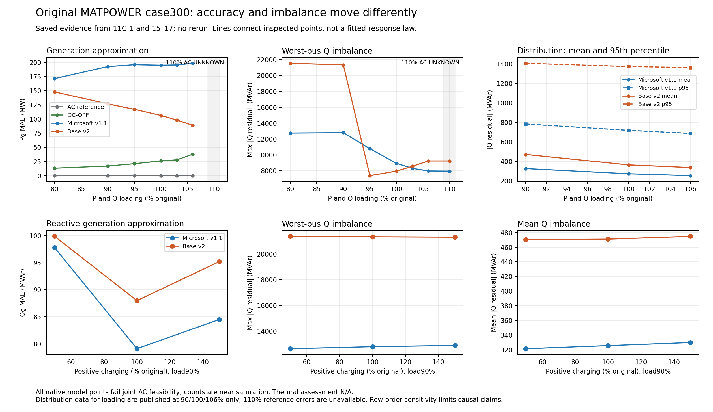

# Original case300: representation gate and evidence synthesis

26 October 2026. **Completed audit; electrical continuation stopped at the correctness gate.** No new electrical inputs, model forwards, AC/DC solves, training or repair were run. Source feature calculations and independent rescoring of recovered base states were run. Discovery 0; confirmation 0. The [preregistered continuation](../../../../docs/experiments/GSFM-018.md) remains unrun.

**Central claim:** on the saved original-order case300 runs, approximation error and native physical validity have different directions. Neither frozen release produced a jointly feasible native point in the audited evidence. New exact-source probes locate deterministic representation differences before the neural forward, so electrical conclusions remain conditional on the evaluated ordering and pipeline. The effect of each feature difference on native predictions is not yet isolated. **No defensible new electrical causal finding is established.**

## What is verified now

Remote `main` was checked and the latest available commit is `b4c2a02720e86482b7e60d3d7d41cc70fc3a2848`, including Experiment17. Experiments12–17 are present; older Windows handoff text claiming 12–14 unrun was stale. Work used a separate checkout, preserving the older checkout and its two untracked drafts. Existing results and environments were not changed. This package is local and was not pushed or sent.

The original case-file hash matches the pin. Reconstructing base AC/v1.1/v2 states from full-precision tracked 11D tables reproduces the historical native-state serialization hashes exactly. Independent complex128 Ybus/Yf/Yt calculations agree with the original FP64 branch evaluator within **7.95e-11 MVA**; residuals reproduce archived diagnostics within **9.17e-11 MVA**. The recovered AC state passes all original constraints; both native model states fail, with P and Q violations at **300/300 buses**. These are labelled recovered derivatives, not newly executed predictions. Raw returned dictionaries and clipping activations remain missing. See [base revalidation](base-revalidation.json).

The complete saved-evidence extraction covers **44 input records / 176 method records**, deduplicating by input SHA to **30 inputs**: 28 electrical inputs and two representation controls. The 28 electrical inputs have **21 accepted AC references, seven UNKNOWN AC outcomes, 28 DC own-law passes, and 0/56 jointly feasible native model points**. Including controls gives 23/30 accepted AC and 0/60 native joint passes. These are dependent variants of one case, not independent grids. All tested inputs, including failures and repeated provenance, are in [existing-inputs.csv](existing-inputs.csv), [existing-methods.csv](existing-methods.csv) and [full source-keyed evidence](existing-evidence.json).

## Representation blocker: narrowed, not closed

| Probe, on electrically equivalent original/reversed inputs | Result | Supportable inference |
|---|---|---|
| Raw feature/endpoints mapping | Exact after mapping | Existing converter equivalence does not imply prepared-feature equivalence. |
| Branch-row reversal, both pinned releases | 112 cycles in each; only 29 supports shared, **83 replaced** | Fundamental-cycle selection depends deterministically on row order. The learned pipeline consumes these cycle quantities; output contribution remains unmeasured. |
| Bus-row reversal, Microsoft v1.1 | 59 of 64 physical landmarks shared; all 300 resistance-moment rows differ, max **0.84705** in feature units | Landmark selection is based on internal bus order. Holding physical landmarks fixed removes this feature discrepancy exactly in the isolated diagnostic. |
| Branch-row reversal, Microsoft v1.1 | Transformer offset is **1 rather than 282**; all 129 transformer DC-feature rows differ, max **39.80054** in feature units | Offset counts appended arrays rather than flattened edges. Correcting only the isolated feature offset removes the mapped branch-only discrepancy; this was not applied to inference or historical results. |
| Repeated same-order feature calculations | Exact repeat in the probe | The identified feature differences do not require stochastic inference or numerical nondeterminism. Full-model nondeterminism has not been measured here. |

The newer v2 source removed the DC/resistance feature pathway; the two Microsoft-only findings cannot explain v2. Whole-cycle sign flips alone are also insufficient evidence of output change: an outer-product cycle operator can cancel a global sign. The [detailed source audit](representation-audit.md) separates sign conventions, changed cycle supports/operators, and untested downstream effects. [Machine-readable probe](representation-probe.json) retains maps, hashes, versions and isolated controls.

Original ordering is fixed within the primary loading/location/charging comparisons. Consequently those paired executions remain valid observations of the released pipeline, and their exact residuals remain meaningful. These probes do not retroactively prove that row order caused every electrical contrast. They do prevent treating those contrasts as representation-independent properties or assigning a universal learned electrical mechanism. No proposed correction replaced a shipped-default prediction.

## Main comparison

Arrows below are numerical before→after values, not uniformly good/bad directions. **E** denotes approximation error (Pg MAE MW or named Qg/Vm MAE); **S** denotes absolute nodal Q-residual severity (max/mean MVAr); **C** denotes actual strict clip counts (Pg/Qg/Vm); AC quantities are physical responses or constraint activity. Counts at bounds are not violations. All model points below fail joint AC feasibility. Thermal assessment is **N/A** throughout.

| Intervention / paired baseline | Expected conventional response | Verified AC-OPF response, from saved runs | DC-OPF response | Microsoft v1.1: accuracy / violations / clipping | Newer base v2: accuracy / violations / clipping | Interpretation / confidence |
|---|---|---|---|---|---|---|
| Global load 100%→106% | More generation; Q/voltage active set may change | Accepted→accepted; Q-bound activity 23→30 | Own-law pass; Pg E 26.09→37.90 | Pg E 195.13→198.53; Q max S 8937.97→7975.34; C 21/8/39→21/9/42 | Pg E 106.40→88.84; Q max S 7958.03→9233.33, mean 363.45→336.15; C 51/27/281→51/27/285 | v2 Pg improves while only its worst Q residual worsens; mean/median/p95 improve. High confidence in saved numbers, limited mechanism. |
| Qd only +10%, baseline100% | AC reactive response; DC state invariant | Accepted→accepted; Q-bound activity 23→29 | State unchanged; Pg E 26.09→36.28 because AC reference changes | Pg E 195.13→192.97; Q max S 8937.97→8882.64; C 21/8/39→22/8/39 | Pg E 106.40→103.47; Q max S 7958.03→8032.93, mean 363.45→370.16; C 51/27/281→50/26/277 | v2 Pg improvement accompanies higher mean/p95/max Q severity. One screened strength. |
| Fixed-total transfer toward lower-admittance group, baseline100% | Totals fixed; local V/Q/losses can change | Accepted→accepted; Q-bound activity 23→23 | Own-law pass; Pg E 26.09→25.76 | Pg E 195.13→194.91; Q max S 8937.97→8901.37; C 21/8/39→21/8/39 | Pg E 106.40→107.11; Q max S 7958.03→21162.29, mean 363.45→536.19; C 51/27/281→50/27/274 | Strongest saved multi-metric severity contrast, almost unchanged Pg error. No nearby confirmation or causal weak-grid claim. |
| Positive charging 100%→150% at90% load | More reactive support; lower-Q bounds may activate; DC unchanged | Accepted→accepted; total Qg5480.33→3146.06 MVAr; lower/upper Q activity6/16→10/11 | State unchanged; Pg E16.99→16.65 due to changed AC reference | Qg E79.12→84.52 MVAr; Vm E0.02751→0.03668 pu; Q max S12796.76→12895.34; C27/7/37→27/8/36 | Qg E88.00→95.20; Vm E0.04643→0.05501; Q max S21338.70→21308.18, mean470.85→474.69; C44/26/280→45/26/281 | Both Qg/Vm errors worsen. v2's slightly lower maximum conceals worse mean/p95. Synthetic parameter intervention. |

The [expanded paired table](existing-pairs.md) also includes P-only +10%, reverse redistribution, reduced charging and UNKNOWN references. At the fixed 0.001 MW/MVAr feasibility tolerance, 73/74 native records in the published 15–17 subset have P/Q counts300/300; only v1.1 at150% charging has299/300. These are record counts including reused points. One fewer P-violating bus does not make the point feasible or indicate broadly improved severity. The extra strict v1.1 Q clip at150% is below the material 0.001 MVAr threshold (material count7→7); the extra v2 voltage clip is below0.0001pu.



## What explains the observations, and what does not

The redistribution moves **63.82 MW and16.02 MVAr**, preserving totals separately, between source-selected positive-load PQ groups at115kV. Lower-|Ybus_ii| buses:609,531,154,173,179; higher group:2,1,77,118,37. This is an admittance proxy, not a measured stability margin. Its v2 Q median98.87→137.79 and p951372.91→1768.52 MVAr also worsen, so this is not solely a maximum-only observation. A causal localization for this transfer remains unavailable without the saved native states.

Prior saved-state diagnostics identify stiff branches as physical amplifiers: at90→95% loading, v2 Vm at235 moves0.94000→1.04786pu while238 stays1.06000; Q outgoing at238 on original branch321 drops18763.58→1563.10MVAr. The worst Q bus moves238→137. This explains how a voltage error can generate a large residual through original equations; it does not explain why the network produced that voltage change. At baseline, oracle reference-Vm substitution reduces maximum Q imbalance to672.68MVAr(v1.1) and619.40MVAr(v2), yet neither point becomes feasible. These are labelled oracle diagnostics, not repairs.

Charging supplies reactive power proportional to voltage squared under the AC equations. Lower required AC Qg and opposite lower/upper-bound movements are expected physics. Native heads need not follow that dispatch; movement of native Vm/Qg, changed reference dispatch, clipping and cancellation can produce different error directions. Same-order feature issues and learned response remain alternative explanations. Lower Pg MAE alone neither proves feasible dispatch nor measures distance to every feasible AC solution.

## Ranked assessment and next decision

1. **Expected physics:** changed Q demand/charging changes AC reactive dispatch and active bounds; DC ignores Qd/charging. This is a useful null control, not novelty.
2. **Useful empirical finding:** scalar approximation error cannot rank native physical validity. Fixed-total redistribution is the strongest saved multi-metric contrast; global loading and charging provide important mixed-metric counterexamples. No native feasible point was found in the audited original-case evidence.
3. **Candidate contribution:** a reproducible release-specific representation audit tied to exact physical scoring. The first deterministic feature discrepancies are isolated, but their native-output contribution and nearby electrical confirmation remain unrun. This is a candidate, not established novelty.
4. **Unresolved:** frozen-forward feature mediation, reference active-set versus native movement for local transfer, full raw artifact portability, and any representation-independent electrical threshold. The [primary-source check](literature-check.md) makes no novelty claim.

**Single next decision for Dr. Li:** prioritize a small frozen-forward feature-isolation audit on the preserved Mac environment before expanding the electrical study. Recover the original/reversed native states and checkpoints, hold each suspect feature block to the mapped baseline separately, and measure how much of the original output discrepancy disappears. Keep those controls separate from released-default results. Only after that gate passes should the preregistered ten new electrical inputs proceed.

## Reproduction and availability

The exact source/checkpoint pins and execution record are in [provenance](provenance.json). Microsoft embedded release identity is `GridSFM-open-v1.1`; no separate checkpoint is inferred from the label "V101". Newer identity is `GridSFM-open-v2`. Checkpoint identity is verified from archived audit/runtime manifests; checkpoint bytes were not newly loaded on Windows.

Across the audited11C/15/16/17 inventories, all281 present compact files match their recorded hashes. Missing local-only file counts are166/425/953/29 respectively. Hashes identify artifacts but do not make them downloadable. The base-state recovery above is a special case; it does not restore other scenarios' raw returns, pre-clipping arrays or model-ready tensors. The Windows feature probe uses Python3.9.10, torch2.7.0+cpu, NumPy2.0.1 and SciPy1.13.1 with extracted exact source functions and a minimal tensor holder; it is not a full PyG/model replay of the historical Mac environment.

From the repository root, with the original pinned case available:

```powershell
python -B experiments/gsfm018/summarize_existing.py
python -B experiments/gsfm018/revalidate_base.py --case <path-to-pinned-case300.m>
```

The representation probe's pinned-source acquisition and exact command are in [representation-audit.md](representation-audit.md). All scripts are in `experiments/gsfm018/`; new files are confined to this experiment, its protocol and top-level status links. Full signed residuals and location details were freshly recomputed only for the recovered base states; absent scenario-level metrics remain absent, never inferred. AC accuracy on UNKNOWN outcomes is N/A; DC Qg/Vm/joint AC feasibility are N/A. No further experiment or publication follows automatically from this report.
